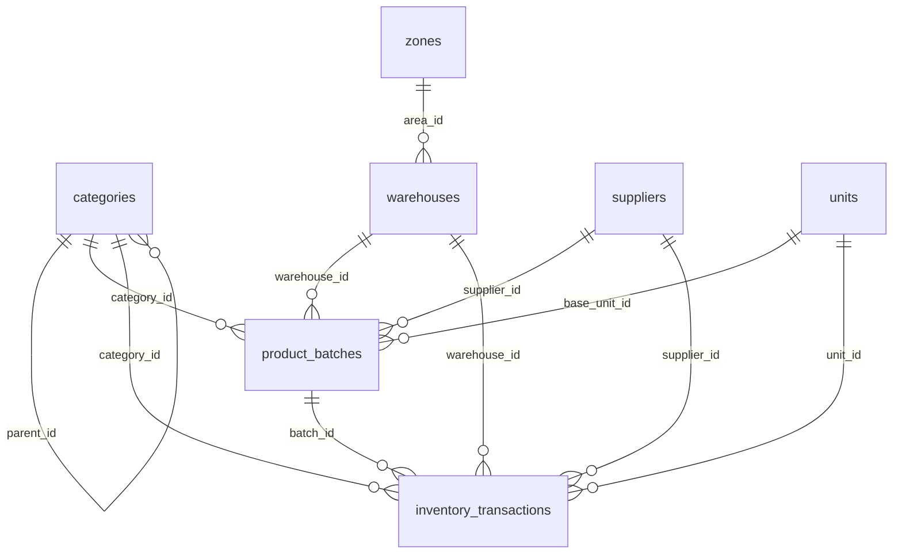

# Thiết Kế Cơ Sở Dữ Liệu Quản Lý Kho Nông Nghiệp (Inventory Database Architecture)

Tài liệu đặc tả kiến trúc cơ sở dữ liệu kho vận hành chuyên biệt cho hệ thống trợ lý ảo nông nghiệp **AgriVoice-AI**, giải quyết triệt để bài toán nhập liệu mờ từ giọng nói của nông dân.

---

## 1. Bối cảnh & Bài toán cốt lõi (The Fuzzy Input Problem)

### 1.1. Thực trạng dữ liệu hiện trường
Trong canh tác thực tế, khẩu lệnh của nhà nông luôn mang tính rút gọn, cảm tính và thiếu chuẩn hóa:
- *"Tôi vừa nhập 2 tấn ngô"* (không rõ nhà cung ứng nào, mã giống gì, bao nhiêu tiền, ngày hết hạn).
- *"Vừa mua 20 bao phân gà"* (không rõ phân ủ mục hay phân tươi, dạng viên hay bao xá, lưu ở kho nào).
- *"Lấy 5 bình thuốc trừ sâu xịt vườn cam"* (nói theo đơn vị bình pha, không nói mã thuốc hay số chai đã khui).

### 1.2. Mâu thuẫn với hệ thống ERP truyền thống
- Các hệ thống kho truyền thống bắt buộc nhập đủ: Mã SKU, Số lô (Lot/Batch ID), Hạn sử dụng, Nhà cung ứng, Vị trí kệ/kho chính xác, Đơn vị cơ sở.
- Nếu ép nhà nông tuân thủ biểu mẫu nghiêm ngặt, họ sẽ bỏ cuộc, dẫn đến dữ liệu chết và hệ thống thất bại.

### 1.3. Định hướng thiết kế
Cơ sở dữ liệu phải đạt được 3 mục tiêu:
1. **Linh hoạt lúc ghi nhận (Flexible Ingestion)**: Chấp nhận dữ liệu khuyết thiếu ban đầu, ghi log ngay vào staging queue (`pending_events`) để không làm gián đoạn công việc hiện trường.
2. **Suy diễn thông minh (AI Semantic Grounding)**: Sử dụng trường tên thuận tiện (`convenient_names`), quan hệ lân cận (`neighboring_areas`) và cây phân cấp (`root_path`) để AI tự suy đoán đối tượng.
3. **Dung sai & Hậu kiểm (Negative Tolerance & Reconciliation)**: Chấp nhận tồn kho âm tạm thời khi phát sinh giao dịch xuất trước nhập sau hoặc lệch danh mục; cung cấp view đối soát tầng gốc để chủ vườn hiệu chỉnh mà không vỡ toàn vẹn dữ liệu.

---

## 2. Các nguyên tắc kiến trúc (Core Design Principles)

1. **Dung thứ số lượng âm tạm thời (Temporary Negative Stock Tolerance)**:
   - Khi nhà nông bón phân hoặc xuất bán nhưng quên khai báo nhập kho trước đó, hoặc mô tả lúc xuất khác nhóm với lúc nhập, số lượng tồn kho được phép nhận giá trị âm.
   - Trạng thái âm không phải lỗi hệ thống mà là chỉ dấu kiểm toán (audit flag) kích thích chủ vườn rà soát.

2. **Mã lô suy diễn tất định (Deterministic Fallback Batch ID)**:
   - Khi không có số lô của nhà sản xuất, hệ thống tự động sinh `batch_code` theo công thức:
     $$\text{BATCH\_ID} = \text{Category\_ID} - \text{Base\_Unit\_ID} - \text{Expiry\_Date}$$
   - Giúp gom nhóm các lần nhập liệu rời rạc có cùng tính chất vật lý và thời hạn.

3. **Cây danh mục Materialized Path (`root_path`, `level`)**:
   - Quản lý cấu trúc danh mục nhiều cấp (Phân bón $\rightarrow$ Phân hữu cơ $\rightarrow$ Phân chuồng $\rightarrow$ Phân gà hoai mục).
   - Truy vấn toàn bộ nhánh con trong $O(1)$ thông qua tiền tố `root_path LIKE '/phan-bon/%'` mà không cần truy vấn đệ quy (recursive CTE) tốn kém tài nguyên trên máy tính nhúng Raspberry Pi.

---

## 3. Chi tiết lược đồ cơ sở dữ liệu (Data Schema Specification)

### 3.1. Từ điển nông trại hợp nhất (`dictionary`)
Hợp nhất danh mục vật tư, nông sản, phân bón, giống cây và **toàn bộ các điểm lưu trữ/kho bãi (`warehouses`)** thành một bảng duy nhất theo kiến trúc cây phân cấp (`root_path`).

> **Giải quyết triệt để lỗi Crash khi thiếu thông tin vị trí**:
> - Người làm vườn khi nói qua voice thường chỉ báo: *"vừa mua 20 bao phân"*, *"xuất 2 bao xịt cam"* mà **không nói cụ thể cất ở kho nào**.
> - Bằng cách gộp kho vào `dictionary` (nhánh `/kho/...`) và đặt trường vị trí lưu trữ `warehouse_id` là **`NULLABLE` (tùy chọn)**, hệ thống không bao giờ bị crash vì lỗi thiếu kho.
> - Trường `convenient_names` (từ điển bí danh dân dã) được áp dụng cho cả hàng hóa lẫn điểm lưu trữ (ví dụ: `["chòi ruộng", "chái bếp", "kho lớn", "lán trại"]`), giúp AI tự động nhận diện nếu nông dân có nhắc tới.

| Tên cột | Kiểu dữ liệu | Ràng buộc | Mục đích & Ý nghĩa |
| :--- | :--- | :--- | :--- |
| `dict_id` / `category_id` | `INTEGER` | `PRIMARY KEY AUTOINCREMENT` | Khóa chính định danh mục từ điển. |
| `code` | `TEXT` | `NOT NULL UNIQUE` | Mã mục ngắn gọn (ví dụ: `CAT_FERT_ORG`, `LOC_SHED_A`, `WH_CENTRAL`). |
| `name` | `TEXT` | `NOT NULL` | Tên chính thức (ví dụ: *Phân hữu cơ vi sinh*, *Chòi chứa phân khu B*, *Nhà kho lớn*). |
| `entry_type` | `TEXT` | `NOT NULL DEFAULT 'CATEGORY'` | Phân loại mục: `CATEGORY` (nhóm hàng/vật tư), `LOCATION` (kho/chòi/điểm lưu trữ), `OTHER`. |
| `parent_id` | `INTEGER` | `NULL REFERENCES dictionary(dict_id)` | Khóa ngoại trỏ về mục cha trong cây phân cấp. |
| `level` | `INTEGER` | `NOT NULL DEFAULT 0` | Cấp bậc trong cây: 0 (Gốc: `/vat-tu`, `/kho`, `/nong-san`), 1 (Nhóm chính), 2 (Nhóm con)... |
| `root_path` | `TEXT` | `NOT NULL DEFAULT '/'` | Đường dẫn phân cấp materialized path (ví dụ: `/vat-tu/phan-bon/`, `/kho/choi-tam/`). |
| `zone_id` | `TEXT` | `NULL REFERENCES zones(zone_id)` | Khu vực địa lý liên kết (nếu mục này là kho/chòi nằm trong một khu vực cụ thể). |
| `default_unit_id` | `INTEGER` | `NULL REFERENCES units(unit_id)` | Đơn vị đo lường mặc định chuẩn hóa cho nhóm hàng này. |
| `requires_expiry_tracking` | `INTEGER` | `DEFAULT 0 CHECK (0, 1)` | Cờ bắt buộc hạn dùng (chỉ áp dụng cho nhóm vật tư). |
| `convenient_names` | `TEXT` | `NULL` | Danh sách JSON bí danh khẩu ngữ nhà nông (ví dụ: `["kho lớn", "chòi vườn B", "chái bếp cũ"]` hoặc `["phân gà", "phân chuồng"]`). |
| `description` | `TEXT` | `NULL` | Mô tả công dụng, tính chất, vị trí thông gió. |
| `is_active` | `INTEGER` | `NOT NULL DEFAULT 1` | Trạng thái kích hoạt (1: đang dùng, 0: ngưng dùng). |
| `updated_at` | `TEXT` | `DEFAULT CURRENT_TIMESTAMP` | Thời điểm cập nhật cuối cùng. |

---

### 3.1.1. Bảng quy đổi đơn vị linh hoạt theo nhóm hàng (`category_unit_conversions`)
Nông dân thường nói theo đơn vị quy ước địa phương (*bao, bình 16L, xô, sọt, chục, thiên*). Bảng này giúp hệ thống tự động quy đổi về đơn vị cơ sở chuẩn (`quantity_base`) mà không bắt nông dân phải tự tính nhẩm.

| Tên cột | Kiểu dữ liệu | Ràng buộc | Mục đích & Ý nghĩa |
| :--- | :--- | :--- | :--- |
| `conversion_id` | `INTEGER` | `PRIMARY KEY AUTOINCREMENT` | Khóa chính bảng quy đổi. |
| `category_id` | `INTEGER` | `NOT NULL REFERENCES dictionary(dict_id) ON DELETE CASCADE` | Áp dụng cho nhóm hàng nào trong từ điển. |
| `unit_id` | `INTEGER` | `NOT NULL REFERENCES units(unit_id)` | Đơn vị thông dụng (ví dụ: `bao`, `bình 16L`, `giỏ 50kg`). |
| `factor_to_base` | `REAL` | `NOT NULL CHECK (factor_to_base > 0)` | Hệ số quy đổi về đơn vị chuẩn (ví dụ: 1 bao = `50.0` kg, 1 bình = `16.0` lít). |
| `is_default_input`| `INTEGER` | `DEFAULT 0 CHECK (is_default_input IN (0, 1))` | Đơn vị mặc định khi nông dân nói nhập hàng. |
| `is_default_output`| `INTEGER`| `DEFAULT 0 CHECK (is_default_output IN (0, 1))`| Đơn vị mặc định khi nói xuất/bón/phun. |

---

### 3.2. Khu vực / Phân khu canh tác (`zones`)
Quản lý không gian địa lý, các lô đất, nhà màng, ao nuôi hoặc chuồng trại. Thống nhất tên bảng là `zones` và khóa chính là `zone_id` trên toàn hệ thống.

| Tên cột | Kiểu dữ liệu | Ràng buộc | Mục đích & Ý nghĩa |
| :--- | :--- | :--- | :--- |
| `zone_id` | `TEXT` | `PRIMARY KEY` | Mã định danh khu vực (ví dụ: `ZONE_CAM_1`, `ZONE_A`, `ZONE_CHUONG_1`). |
| `name` | `TEXT` | `NOT NULL` | Tên hiển thị chính thức (ví dụ: *Vườn Cam Xoàn 1*, *Nhà màng dưa lưới 2*). |
| `sector` | `TEXT` | `DEFAULT 'MIXED'` | Mảng sản xuất: `CROP` (trồng trọt), `LIVESTOCK` (chăn nuôi), `AQUACULTURE` (thủy sản), `MIXED` (kết hợp). |
| `area_size` | `REAL` | `CHECK (area_size >= 0)` | Diện tích hoặc quy mô mặt bằng canh tác. |
| `unit_of_size` | `TEXT` | `DEFAULT 'm2'` | Đơn vị diện tích (`m2`, `ha`, `sao`, `cong`). |
| `neighboring_zone_ids` | `TEXT` | `NULL` | Danh sách JSON các khu vực tiếp giáp (ví dụ: `["ZONE_A", "ZONE_B"]`). Giúp AI suy luận ngữ cảnh khi nghe khẩu lệnh *"bón phân chỗ giáp ranh khu A"*. |
| `convenient_names` | `TEXT` | `NULL` | Bí danh địa phương (ví dụ: `["vườn sau nhà", "đất biền", "khu ao cá cũ"]`). |
| `description` | `TEXT` | `NULL` | Đặc điểm thổ nhưỡng, nguồn nước, ghi chú lịch sử canh tác. |
| `updated_at` | `TEXT` | `DEFAULT CURRENT_TIMESTAMP` | Thời điểm cập nhật cuối cùng. |

---

### 3.3. Bên cung ứng vật tư (`suppliers`)
Quản lý đối tác phân phối, đại lý giống, phân bón, thuốc BVTV phục vụ truy xuất nguồn gốc và hạch toán công nợ.

| Tên cột | Kiểu dữ liệu | Ràng buộc | Mục đích & Ý nghĩa |
| :--- | :--- | :--- | :--- |
| `supplier_id` | `INTEGER` | `PRIMARY KEY AUTOINCREMENT` | Khóa chính bên cung ứng. |
| `name` | `TEXT` | `NOT NULL` | Tên cửa hàng / đại lý (ví dụ: *Đại lý vật tư Năm Lúa*). |
| `code` | `TEXT` | `NOT NULL UNIQUE` | Mã đại lý (ví dụ: `SUPP_NAM_LUA`). |
| `contact_info` | `TEXT` | `NULL` | Số điện thoại, người liên hệ, địa chỉ (gộp chung dạng text hoặc JSON để đơn giản hóa). |
| `resources_path` | `TEXT` | `NULL` | Đường dẫn thư mục lưu ảnh hóa đơn, chứng từ giấy, phiếu cân hàng trên thiết bị (ví dụ: `/data/media/suppliers/supp_01/`). |
| `convenient_names` | `TEXT` | `NULL` | Bí danh nhà nông quen gọi (ví dụ: `["chỗ anh Năm", "tiệm bà Ba", "đại lý đầu cầu"]`). |
| `reliability_rating`| `REAL` | `DEFAULT 5.0` | Đánh giá độ tin cậy chất lượng hàng hóa (thang điểm 1.0 - 5.0). |
| `description` | `TEXT` | `NULL` | Ghi chú chính sách nợ, phương thức giao hàng. |
| `updated_at` | `TEXT` | `DEFAULT CURRENT_TIMESTAMP` | Thời điểm cập nhật. |

---

### 3.4. Nhật ký biến động xuất - nhập kho (`inventory_transactions`)
Sổ cái ghi chép chi tiết từng lần dịch chuyển hàng hóa. Lưu trữ đầy đủ dữ kiện thô dù khẩu lệnh ban đầu có thể chưa hoàn chỉnh.

| Tên cột | Kiểu dữ liệu | Ràng buộc | Mục đích & Ý nghĩa |
| :--- | :--- | :--- | :--- |
| `transaction_id` | `INTEGER` | `PRIMARY KEY AUTOINCREMENT` | Khóa chính nhật ký giao dịch. |
| `item_name` | `TEXT` | `NOT NULL` | Tên mặt hàng do người dùng đọc (ví dụ: *Ngô hạt*, *Phân gà Đầu Trâu*). |
| `category_id` | `INTEGER` | `NOT NULL REFERENCES dictionary(dict_id)` | Nhóm hàng trong từ điển. |
| `warehouse_id` | `INTEGER` | `NULL REFERENCES dictionary(dict_id)` | **Vị trí kho/chòi lưu trữ (TÙY CHỌN - NULL nếu nông dân không nói)**. Tránh crash! |
| `supplier_id` | `INTEGER` | `REFERENCES suppliers(supplier_id)` | Nhà cung cấp (nếu là giao dịch nhập). |
| `batch_id` | `INTEGER` | `REFERENCES product_batches(batch_id)` | Mã liên kết lô tồn kho (tự động ghép hoặc tạo mới). |
| `transaction_type` | `TEXT` | `NOT NULL` | Loại giao dịch: `RECEIPT` (nhập), `ISSUE` (xuất), `ADJUSTMENT` (điều chỉnh kiểm kê), `DISCARD` (thanh lý hư hỏng). |
| `quantity_change` | `REAL` | `NOT NULL CHECK (quantity_change <> 0)` | Lượng biến động: giá trị dương (+) khi nhập, giá trị âm (-) khi xuất. |
| `unit_id` | `INTEGER` | `REFERENCES units(unit_id)` | Đơn vị tính của số lượng biến động (bao, tấn, kg, lít...). |
| `quantity_base` | `REAL` | `NOT NULL` | Số lượng quy đổi chuẩn về đơn vị cơ sở (`base_unit`) của nhóm. |
| `unit_price_vnd` | `INTEGER` | `DEFAULT 0` | Đơn giá mua hoặc xuất kho (VND). |
| `expiry_date` | `TEXT` | `NULL` | Ngày hết hạn của hàng hóa (nếu nhà nông có đọc). |
-| `voice_log_id` | `INTEGER` | `NULL` | ID liên kết ngược về `voice_raw_logs` để nghe lại file âm thanh gốc khi đối soát. |
+| `pending_event_id` | `INTEGER` | `NULL REFERENCES pending_events(event_id) ON DELETE SET NULL` | ID liên kết ngược về hàng đợi `pending_events` để nghe lại âm thanh gốc khi đối soát. |
+| `cycle_id` | `INTEGER` | `NULL REFERENCES production_cycles(cycle_id) ON DELETE SET NULL` | Vụ mùa tiêu thụ vật tư (dùng hạch toán chi phí trực tiếp cho vụ mùa). |
+| `financial_transaction_id` | `INTEGER` | `NULL REFERENCES financial_transactions(transaction_id) ON DELETE SET NULL` | Phiếu chi/thu tiền đối ứng nếu giao dịch mua/bán đã thanh toán. |
+| `is_price_estimated` | `INTEGER` | `DEFAULT 0 CHECK (is_price_estimated IN (0, 1))` | Đánh dấu 1 nếu đơn giá là do AI tự suy đoán (khi nông dân quên nói giá), hỗ trợ chủ vườn rà soát. |
| `notes` | `TEXT` | `NULL` | Ghi chú thêm lý do xuất nhập, người nhận hàng. |
| `created_at` | `TEXT` | `DEFAULT CURRENT_TIMESTAMP` | Thời điểm phát sinh giao dịch. |

---

### 3.5. Bảng theo dõi tồn kho chi tiết theo lô (`product_batches`)
Quản lý tồn kho thực tế ở tầng chi tiết theo hạn dùng và nguồn gốc. **Cho phép số lượng âm** khi phát sinh tình huống thực tế.

| Tên cột | Kiểu dữ liệu | Ràng buộc | Mục đích & Ý nghĩa |
| :--- | :--- | :--- | :--- |
| `batch_id` | `INTEGER` | `PRIMARY KEY AUTOINCREMENT` | Khóa chính quản lý lô. |
| `batch_code` | `TEXT` | `NOT NULL UNIQUE` | Mã lô vật lý hoặc mã suy diễn tất định (`CAT_01-U_KG-20261231`). |
| `category_id` | `INTEGER` | `NOT NULL REFERENCES dictionary(dict_id)` | Nhóm vật tư của lô trong từ điển. |
| `warehouse_id` | `INTEGER` | `NULL REFERENCES dictionary(dict_id)` | **Kho/Điểm lưu trữ (TÙY CHỌN - NULL nếu không rõ vị trí)**. |
| `supplier_id` | `INTEGER` | `REFERENCES suppliers(supplier_id)` | Nhà cung cấp lô hàng. |
| `quantity_remaining` | `REAL` | `NOT NULL DEFAULT 0.0` | **Số lượng tồn kho thực tế (có thể âm).** Thể hiện lượng hàng đang thiếu hụt hồ sơ khai báo. |
| `base_unit_id` | `INTEGER` | `REFERENCES units(unit_id)` | Đơn vị chuẩn hóa cơ sở của lô (kg, lít, cái). |
| `expiry_date` | `TEXT` | `NULL` | Hạn dùng của lô (`YYYY-MM-DD`). |
| `is_virtual` | `INTEGER` | `DEFAULT 0 CHECK (0, 1)` | Đánh dấu lô ảo sinh ra tự động do xuất trước nhập sau (1: lô ảo, 0: lô có nhập thực). |
| `status` | `TEXT` | `DEFAULT 'AVAILABLE'` | Trạng thái: `AVAILABLE` (khả dụng), `DEPLETED` (hết hàng), `EXPIRED` (hết hạn), `NEGATIVE_ALERT` (cảnh báo tồn âm). |
| `updated_at` | `TEXT` | `DEFAULT CURRENT_TIMESTAMP` | Thời điểm cập nhật biến động cuối cùng. |

---

### 3.6. View tổng hợp tồn kho theo nhóm gốc (`v_inventory_root_summary`)
Khung nhìn (SQL View) tổng hợp toàn bộ vật tư về nhóm cấp cao nhất (Root Category, `level = 0`) trong bảng từ điển `dictionary` nhằm phát hiện sai lệch phân loại của nhà nông.
        name AS root_name
    FROM categories
    WHERE parent_id IS NULL OR level = 0

    UNION ALL

    -- Đệ quy tìm các nhóm con trỏ về nhóm gốc
    SELECT 
        c.category_id AS current_id,
        ct.root_id,
        ct.root_name
    FROM categories c
    JOIN category_tree ct ON c.parent_id = ct.current_id
)
SELECT 
    ct.root_id,
    ct.root_name,
    pb.warehouse_id,
    w.name AS warehouse_name,
    pb.base_unit_id,
    u.name AS unit_name,
    ROUND(SUM(pb.quantity_remaining), 3) AS total_quantity,
    CASE 
        WHEN SUM(pb.quantity_remaining) < 0 THEN 'NEGATIVE_ANOMALY'
        WHEN SUM(pb.quantity_remaining) = 0 THEN 'EMPTY'
        ELSE 'IN_STOCK'
    END AS inventory_health,
    COUNT(DISTINCT pb.batch_id) AS active_batches_count,
    MIN(pb.expiry_date) AS nearest_expiry_date,
    MAX(pb.updated_at) AS last_updated_at
FROM product_batches pb
JOIN category_tree ct ON pb.category_id = ct.current_id
JOIN units u ON pb.base_unit_id = u.unit_id
JOIN warehouses w ON pb.warehouse_id = w.warehouse_id
GROUP BY ct.root_id, ct.root_name, pb.warehouse_id, w.name, pb.base_unit_id, u.name;
```

---

## 4. Cơ chế vận hành đặc thù (Operational Mechanisms)

```
[Khẩu lệnh Voice] ──> [AI Trích xuất & Map Convenient Names]
                            │
                            ▼
                     [Pending Queue] ──(Duyệt tuần tự)──► [Giao dịch Kho]
                                                               │
                                                               ▼
[Đối soát View Tồn Kho Gốc] ◄── [Tồn Âm Cảnh Báo] ◄── [Cập nhật Lô Chi Tiết]
```

### 4.1. Quy trình xử lý tồn kho âm (Negative Quantity Handling)
- **Tình huống**: Bác làm vườn đọc: *"Đem 5 bao phân gà ra bón khu A"*. Trong kho chưa từng có log nhập *Phân gà* (do lúc mua không nói vào máy).
- **Hành động của hệ thống**:
  1. AI nhận diện nhóm hàng `Phân gà hoai mục` (thuộc gốc `Phân bón`).
  2. Hệ thống kiểm tra xem kho có lô nào khớp không. Nếu không có, tự động tạo một lô ảo (`is_virtual = 1`, `quantity_remaining = -5.0 bao`, `status = 'NEGATIVE_ALERT'`).
  3. Ghi nhận nhật ký xuất kho bình thường để không chặn công việc sản xuất hiện trường.
  4. Bắn thông báo lên hệ thống cho Chủ vườn: *"Kho B đang thiếu hụt 5 bao phân gà (Tồn âm). Vui lòng rà soát lại việc nhập hàng."*
  5. Khi chủ vườn nhập hóa đơn mua hàng sau đó, hệ thống cấn trừ lượng âm, đưa tồn kho về giá trị dương thực tế.

### 4.2. Giải quyết mâu thuẫn danh mục bằng View Gốc
- **Tình huống**: Lúc mua, bác nông dân nói chi tiết: *"Mua 1 tấn ngô lai F1"*. Lúc dùng cho bò ăn, bác chỉ nói: *"Lấy 200kg thức ăn thô"*.
- **Hệ quả**: Nếu quản lý cứng, lô *Ngô lai F1* thừa tồn, trong khi lô *Thức ăn thô* bị âm.
- **Giải pháp**: 
  - Khung nhìn `v_inventory_root_summary` gom toàn bộ về nhóm gốc `Thức ăn chăn nuôi`.
  - Tổng tồn kho nhóm gốc vẫn cân bằng dương: $+1000\text{ kg} - 200\text{ kg} = +800\text{ kg}$.
  - Chủ vườn nhìn vào View này biết ngay trang trại không bị mất mát tài sản, chỉ là độ lệch mô tả giữa các lần ghi voice.

### 4.3. Theo dõi hạn sử dụng tự động (`requires_expiry_tracking`)
- Khi một giao dịch thuộc danh mục có cờ `requires_expiry_tracking = 1` được ghi nhận:
  - Nếu khẩu lệnh có chứa hạn dùng (ví dụ: *"Hạn dùng tháng 12 năm 2027"*), AI điền vào `expiry_date`.
  - Nếu khẩu lệnh **không có** thông tin hạn dùng, hệ thống tự động tạo một sự cố cảnh báo vào bảng `issues` (`title = 'Vật tư nhập thiếu hạn sử dụng'`, `severity = 'LOW'`) để nhắc chủ vườn kiểm tra lại vỏ bao bì khi có thời gian.

---

## 5. Bảng tổng hợp ánh xạ thực thể (Entity Relationship Overview)



---

## 6. Kết luận & Khuyến nghị kỹ thuật
1. **Không tạo bảng `products` cứng nhắc làm rào cản**: Với nông nghiệp hộ gia đình và trang trại vừa/nhỏ, phân loại theo `categories` phân cấp linh hoạt kết hợp mã lô tất định (`product_batches`) mang lại hiệu quả cao hơn nhiều so với việc bắt buộc tạo danh mục sản phẩm cố định trước khi cho phép nhập kho.
2. **Khai thác tối đa trường `convenient_names`**: Khi bổ sung thêm danh mục, khu vực hoặc kho mới, luôn cập nhật các biến thể khẩu ngữ địa phương vào `convenient_names` để mô hình AI nhận diện chính xác ngay lần đầu bóc băng.
3. **Giữ nguyên tính toán bất biến ở tầng Logs**: Bảng `inventory_transactions` chỉ ghi thêm (append-only), không chỉnh sửa lịch sử (immutable log). Mọi thao tác sửa sai, kiểm kê đều phải thực hiện bằng một bản ghi bù trừ (`ADJUSTMENT`) để đảm bảo tính minh bạch kiểm toán nông trại.
