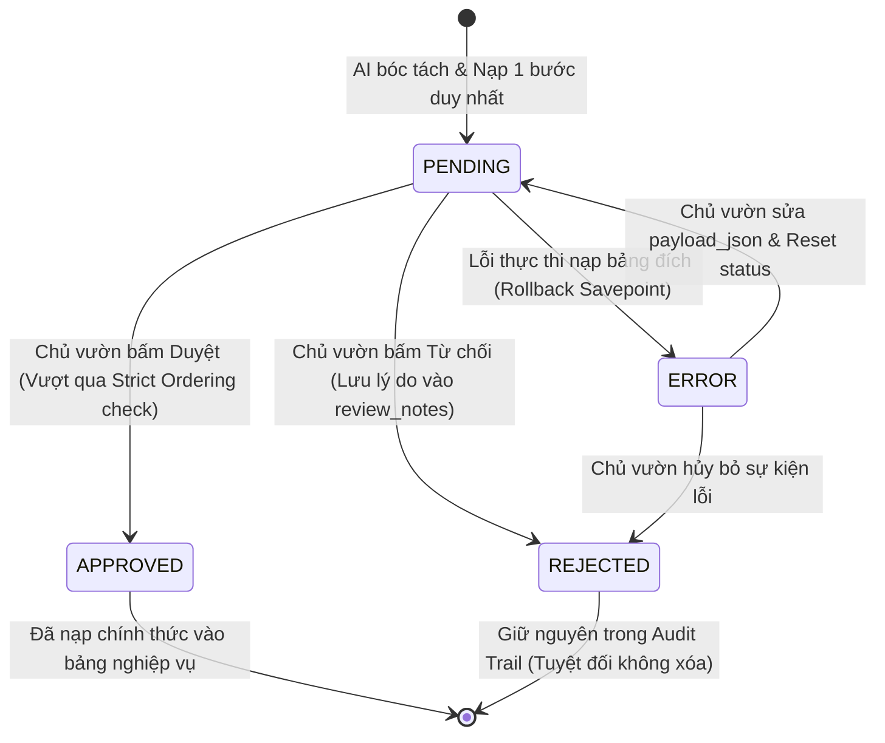
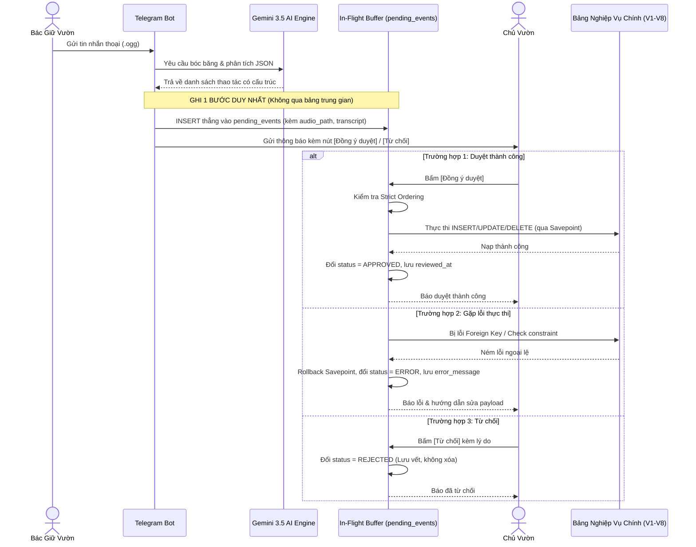

# Thiết Kế Cơ Sở Dữ Liệu Vùng Đệm Chờ Duyệt Hợp Nhất (Unified In-Flight Buffer Architecture)

Tài liệu đặc tả kiến trúc cơ sở dữ liệu vùng đệm chuyển tiếp và hàng đợi kiểm duyệt dữ liệu (Unified In-Flight Buffer & Audit Trail) cho hệ thống trợ lý ảo nông nghiệp **AgriVoice-AI**. 

> **Quyết định kiến trúc tinh giản**: **Loại bỏ hoàn toàn bảng `voice_raw_logs`**. Hợp nhất toàn bộ thông tin nguồn (file âm thanh gốc, văn bản bóc băng, người gửi) và dữ liệu tác vụ (payload JSON, bảng đích, trạng thái duyệt) vào **một bảng duy nhất: `pending_events`**.

---

## 1. Phân tích loại bỏ bảng `voice_raw_logs` (Redundancy Analysis & Deprecation)

### 1.1. Thực trạng trùng lặp dữ liệu (Field-level Duplication)
Khi đối chiếu hai bảng trong kiến trúc ban đầu, hơn 70% trường dữ liệu bị trùng lặp hoàn toàn:

| Thuộc tính | Bảng `voice_raw_logs` | Bảng `pending_events` | Đánh giá dư thừa |
| :--- | :--- | :--- | :--- |
| **Mã định danh** | `log_id` | `event_id` (kèm FK `log_id`) | Thừa khóa ngoại liên kết |
| **Thời điểm phát ngôn**| `timestamp` | `timestamp` | **Trùng lặp 100%** |
| **Người gửi Telegram** | `sender_id` | `sender_id` | **Trùng lặp 100%** |
| **File âm thanh** | `audio_file_path` | `audio_path` | **Trùng lặp 100%** |
| **Văn bản bóc băng** | `raw_transcript` | `raw_transcript` | **Trùng lặp 100%** |
| **Chi tiết lỗi** | `error_message` | `error_message` | **Trùng lặp 100%** |
| **Dữ liệu phân tích AI** | `ai_response_json` | `payload_json` | `payload_json` là dữ liệu thực thi chính xác |
| **Trạng thái** | `execution_status` | `status` | `status` của event bao quát hơn |

### 1.2. Tại sao `voice_raw_logs` không cần thiết?
1. **Lãng phí I/O trên Raspberry Pi**:
   - Mỗi tin nhắn thoại trước đây phải thực hiện 2 lần ghi (`INSERT INTO voice_raw_logs` $\rightarrow$ lấy `lastrowid` $\rightarrow$ `INSERT INTO pending_events` $\rightarrow$ `UPDATE pending_events.log_id`).
   - Việc ghi 2 bảng liên tiếp làm tăng độ trễ và nhanh hao mòn thẻ nhớ microSD của Pi.
2. **Khẩu lệnh tra cứu / Hỏi đáp (Q&A Query) không cần lưu vào bảng duyệt**:
   - Khi bác nông dân hỏi: *"Khu A diện tích bao nhiêu?"* hay *"Hiện tại còn bao nhiêu bao phân?"*, AI gọi các tool `search_*` và trả lời ngay tức thì trên Telegram. 
   - Những câu hỏi dạng đọc (read-only) này hoàn toàn không tạo ra biến động trạng thái trang trại, không cần chủ vườn duyệt, nên không cần ép phải lưu vào DB bảng biểu làm phình dung lượng. Nếu cần debug thì chỉ cần ghi log file dạng text xoay vòng (`loguru` / rotating log files).
3. **Trường hợp 1 voice sinh nhiều hành động (Multi-action Voice)**:
   - Khi bác nông dân nói: *"Xuất 10 bao phân cho khu B và van nước số 2 bị gãy"*:
   - Cả 2 bản ghi `pending_events` (1 xuất kho, 1 sự cố) hoàn toàn có thể trỏ cùng một `audio_path` và `raw_transcript`.
   - Chủ vườn bấm nghe lại trên thẻ duyệt của hành động nào cũng đều nghe được ngữ cảnh đầy đủ của cả câu nói mà không cần join sang bảng `voice_raw_logs`.

---

## 2. Các nguyên tắc vận hành cốt lõi (Core Principles)

```
[Bác nông dân đọc Voice]
          │
          ▼
 [AI Whisper/Gemini bóc tách]
          │
          ▼
┌────────────────────────────────────────────────────────┐
│     BẢNG DUY NHẤT: PENDING_EVENTS (In-Flight Buffer)   │
│  - Lưu file âm thanh gốc (audio_path)                  │
│  - Lưu văn bản bóc băng (raw_transcript)               │
│  - Lưu dữ liệu thực thi đã đóng gói (payload_json)     │
│  - Quản lý trạng thái: PENDING -> APPROVED / REJECTED  │
└──────────────────────────┬─────────────────────────────┘
                           │
      ┌────────────────────┼────────────────────┐
      ▼                    ▼                    ▼
[v_pending_events_queue] [v_pending_events_errors] [v_pending_events_history]
 (Hàng đợi duyệt tuần tự) (Rà soát lỗi thực thi)   (Kiểm toán toàn diện)
```

1. **Cách ly an toàn (Staging Sandbox)**: AI không bao giờ ghi trực tiếp vào bảng nghiệp vụ chính thức. Toàn bộ dữ liệu nằm lại trong `pending_events` chờ phê duyệt.
2. **Duyệt tuần tự nghiêm ngặt (Strict Chronological Ordering)**: 
   - Sắp xếp và ép duyệt tuần tự theo cặp $(t_{\text{event}} \text{ ASC}, \text{event\_id} \text{ ASC})$.
   - Bắt buộc xử lý các sự kiện diễn ra trước (nhập kho, bắt đầu vụ) trước khi duyệt các sự kiện diễn ra sau (xuất kho, thu hoạch).
3. **Phục hồi lỗi bằng Savepoint (Atomic Error Recovery)**:
   - Khi duyệt, hệ thống dùng `SAVEPOINT`. Nếu bảng đích vi phạm ràng buộc dữ liệu, tự động rollback và chuyển trạng thái sang `ERROR` lưu kèm `error_message`.
   - Chủ vườn có thể nghe lại audio, sửa trực tiếp `payload_json` và chuyển lại `PENDING` để duyệt lại.
4. **Lớp phủ ảo thời gian thực (Virtual Pending Overlay)**:
   - Khi người dùng hỏi thông tin hiện tại, phương thức `get_data_with_pending_applied` mô phỏng thực thi các sự kiện `PENDING` trên RAM để trả lời tức thì dữ liệu mới nhất mà không bắt chủ vườn phải duyệt trước.

---

## 3. Chi tiết lược đồ cơ sở dữ liệu (Data Schema Specification)

### 3.1. Bảng hàng đợi kiểm duyệt hợp nhất (`pending_events`)

| Tên cột | Kiểu dữ liệu | Ràng buộc | Mục đích & Ý nghĩa |
| :--- | :--- | :--- | :--- |
| `event_id` | `INTEGER` | `PRIMARY KEY AUTOINCREMENT` | Khóa chính định danh sự kiện In-Flight. |
| `sender_id` | `TEXT` | `NOT NULL` | Telegram User ID của người nói (liên kết `telegram_id` trong `collaborators`). |
| `timestamp` | `TEXT` | `NOT NULL DEFAULT CURRENT_TIMESTAMP` | Mốc thời gian phát ngôn thực tế. Dùng làm khóa sắp xếp duyệt tuần tự (`Strict Ordering`). |
| `target_table` | `TEXT` | `NOT NULL CHECK (length(trim(target_table)) > 0)` | Bảng nghiệp vụ đích (ví dụ: `inventory_transactions`, `tasks`, `issues`, `financial_transactions`, `production_cycles`). |
| `action_type` | `TEXT` | `NOT NULL CHECK (action_type IN ('INSERT', 'UPDATE', 'DELETE'))` | Hành động can thiệp dữ liệu: Thêm mới, Sửa đổi hoặc Xóa. |
| `audio_path` | `TEXT` | `NULL` | Đường dẫn file âm thanh `.ogg` gốc trên ổ cứng Pi để chủ vườn bấm nghe lại bất kỳ lúc nào. |
| `raw_transcript` | `TEXT` | `NOT NULL DEFAULT ''` | Văn bản bóc băng gốc từ AI để chủ vườn đối chiếu trực tiếp bằng mắt. |
| `summary_text` | `TEXT` | `NULL` | Tóm tắt ngắn gọn sự kiện (ví dụ: *Xuất 10 bao phân NPK cho Vườn Cam 1*). Dùng làm tiêu đề thẻ thông báo Telegram. |
| `payload_json` | `TEXT` | `NOT NULL CHECK (json_valid(payload_json))` | **Dữ liệu JSON đóng gói toàn bộ nội dung cần ghi vào bảng đích.** |
| `status` | `TEXT` | `NOT NULL DEFAULT 'PENDING' CHECK (status IN ('PENDING', 'APPROVED', 'REJECTED', 'ERROR'))` | Trạng thái kiểm duyệt: `PENDING` (chờ duyệt), `APPROVED` (đã duyệt & đã nạp), `REJECTED` (từ chối), `ERROR` (lỗi khi nạp bảng đích). |
| `error_message` | `TEXT` | `NULL` | Thông báo chi tiết lỗi thực thi nếu `status = 'ERROR'`. |
| `reviewed_by` | `INTEGER` | `NULL REFERENCES collaborators(collaborator_id) ON DELETE SET NULL` | ID chủ vườn hoặc quản lý thực hiện bấm duyệt/từ chối. |
| `reviewed_at` | `TEXT` | `NULL` | Thời điểm duyệt hoặc từ chối (tự động cập nhật qua trigger). |
| `review_notes` | `TEXT` | `NULL` | Ghi chú của chủ vườn khi duyệt hoặc lý do từ chối. |
| `created_at` | `TEXT` | `NOT NULL DEFAULT CURRENT_TIMESTAMP` | Thời điểm bản ghi được tạo trong hệ thống. |
| `updated_at` | `TEXT` | `NOT NULL DEFAULT CURRENT_TIMESTAMP` | Thời điểm cập nhật cuối cùng. |

---

### 3.2. Chỉ mục tối ưu hóa truy vấn (Performance Indexes)

```sql
-- Chi muc quan trong nhat: Phuc vu hang doi duyet tuan tu nghiem ngat
CREATE INDEX IF NOT EXISTS idx_pending_events_queue
    ON pending_events(status, timestamp ASC, event_id ASC);

-- Chi muc loc theo bang dich va trang thai (phuc vu Virtual Overlay)
CREATE INDEX IF NOT EXISTS idx_pending_events_target_status
    ON pending_events(target_table, status);

-- Chi muc phan tich theo nguoi noi
CREATE INDEX IF NOT EXISTS idx_pending_events_sender
    ON pending_events(sender_id);

-- Chi muc kiem toan theo nguoi duyet
CREATE INDEX IF NOT EXISTS idx_pending_events_reviewed_by
    ON pending_events(reviewed_by);
```

---

### 3.3. Các Triggers tự động hóa (Automated Triggers)

```sql
-- Tu dong cap nhat updated_at khi sua doi ban ghi
CREATE TRIGGER IF NOT EXISTS trg_pending_events_updated_at
AFTER UPDATE ON pending_events
FOR EACH ROW
WHEN NEW.updated_at = OLD.updated_at
BEGIN
    UPDATE pending_events
    SET updated_at = CURRENT_TIMESTAMP
    WHERE event_id = NEW.event_id;
END;

-- Tu dong ghi nhan reviewed_at ngay khi status chuyen sang APPROVED hoac REJECTED
CREATE TRIGGER IF NOT EXISTS trg_pending_events_auto_reviewed_at
BEFORE UPDATE OF status ON pending_events
FOR EACH ROW
WHEN NEW.status IN ('APPROVED', 'REJECTED') AND NEW.reviewed_at IS NULL
BEGIN
    UPDATE pending_events
    SET reviewed_at = CURRENT_TIMESTAMP
    WHERE event_id = NEW.event_id;
END;
```

---

### 3.4. Các Khung nhìn vận hành chuyên trách (Operating Views)

#### View 1: Hàng đợi duyệt tuần tự nghiêm ngặt (`v_pending_events_queue`)
Truy vấn sự kiện đang chờ duyệt tiếp theo theo trật tự thời gian phát ngôn từ cũ đến mới:
```sql
CREATE VIEW IF NOT EXISTS v_pending_events_queue AS
SELECT
    p.event_id,
    p.sender_id,
    p.timestamp,
    p.target_table,
    p.action_type,
    p.audio_path,
    p.raw_transcript,
    p.summary_text,
    p.payload_json,
    p.status,
    p.error_message,
    p.reviewed_by,
    c.full_name AS reviewer_name,
    p.reviewed_at,
    p.review_notes,
    p.created_at,
    p.updated_at
FROM pending_events p
LEFT JOIN collaborators c ON p.reviewed_by = c.collaborator_id
WHERE p.status = 'PENDING'
ORDER BY p.timestamp ASC, p.event_id ASC;
```

#### View 2: Danh sách sự cố lỗi thực thi (`v_pending_events_errors`)
Lọc các sự kiện bị lỗi khi nạp vào bảng đích để chủ vườn xử lý:
```sql
CREATE VIEW IF NOT EXISTS v_pending_events_errors AS
SELECT
    p.event_id,
    p.sender_id,
    p.timestamp,
    p.target_table,
    p.action_type,
    p.audio_path,
    p.raw_transcript,
    p.summary_text,
    p.payload_json,
    p.status,
    p.error_message,
    p.reviewed_by,
    c.full_name AS reviewer_name,
    p.reviewed_at,
    p.review_notes,
    p.created_at,
    p.updated_at
FROM pending_events p
LEFT JOIN collaborators c ON p.reviewed_by = c.collaborator_id
WHERE p.status = 'ERROR'
ORDER BY p.timestamp DESC, p.event_id DESC;
```

#### View 3: Lịch sử kiểm toán toàn diện (`v_pending_events_history`)
Lưu trữ toàn bộ lịch sử các sự kiện đã xử lý, sắp xếp từ mới nhất về cũ nhất:
```sql
CREATE VIEW IF NOT EXISTS v_pending_events_history AS
SELECT
    p.event_id,
    p.sender_id,
    p.timestamp,
    p.target_table,
    p.action_type,
    p.audio_path,
    p.raw_transcript,
    p.summary_text,
    p.payload_json,
    p.status,
    p.error_message,
    p.reviewed_by,
    c.full_name AS reviewer_name,
    p.reviewed_at,
    p.review_notes,
    p.created_at,
    p.updated_at
FROM pending_events p
LEFT JOIN collaborators c ON p.reviewed_by = c.collaborator_id
ORDER BY p.timestamp DESC, p.event_id DESC;
```

---

## 4. Máy trạng thái & Quy trình thực thi (State Machine & Execution Flow)

### 4.1. Sơ đồ trạng thái sự kiện In-Flight



---

### 4.2. Luồng xử lý đơn giản hóa 1 bước (Streamlined Ingestion Flow)



---

## 5. Chuẩn hóa cấu trúc `payload_json` theo hành động

Hệ thống hỗ trợ 3 quy cách `payload_json` tự động tương ứng với hành động:

### 5.1. Thao tác `INSERT`
Payload là dictionary chứa các trường của bảng đích:
```json
{
  "zone_id": "ZONE_VUON_CAM",
  "title": "Rầy mềm bám lá non",
  "severity": "HIGH",
  "status": "OPEN",
  "reported_by": "Bác giữ vườn"
}
```

### 5.2. Thao tác `UPDATE`
Hỗ trợ cả cập nhật trực tiếp theo khóa chính hoặc theo khối `{where, data}`:
```json
{
  "where": { "zone_id": "ZONE_A", "status": "OPEN" },
  "data": { "status": "IN_PROGRESS", "notes": "Đang chuẩn bị phun thuốc" }
}
```

### 5.3. Thao tác `DELETE`
Chỉ định khóa hoặc điều kiện dòng cần xóa (từ chối payload rỗng `{}` để bảo vệ toàn bảng):
```json
{
  "issue_id": 15
}
```

---

## 6. Kết luận & Lợi ích kiến trúc

1. **Giảm 50% thao tác I/O đĩa trên Raspberry Pi**:
   - Loại bỏ hoàn toàn bảng `voice_raw_logs` giúp mỗi tin nhắn thoại chỉ tốn đúng 1 lệnh `INSERT`, giảm thiểu độ trễ và kéo dài tuổi thọ thẻ nhớ microSD.
2. **Loại bỏ khóa ngoại và truy vấn Join thừa thãi**:
   - Không còn quan hệ `log_id` giữa 2 bảng. Mỗi bản ghi `pending_events` là một thực thể độc lập đầy đủ ngữ cảnh (ai nói, nói lúc nào, file âm thanh ở đâu, văn bản là gì, dữ liệu bóc tách là gì).
3. **Mã nguồn tinh giản, dễ bảo trì**:
   - Không cần đồng bộ trạng thái giữa `voice_raw_logs.execution_status` và `pending_events.status`. Toàn bộ vòng đời sự kiện chỉ xoay quanh một trường `status` duy nhất.
4. **Bảo toàn 100% giá trị kiểm toán (Zero Data Loss)**:
   - Dù bỏ bảng `voice_raw_logs`, hệ thống vẫn bảo tồn trọn vẹn file ghi âm gốc, transcript và phản hồi đã đóng gói của AI bên trong `pending_events`.
