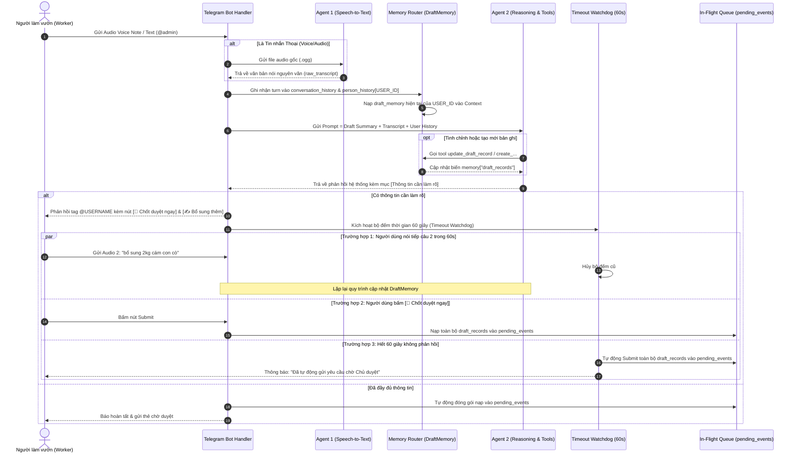

# Kiến Trúc Quản Lý Hội Thoại Đa Tác Nhân Phi Trạng Thái Trong Nhóm Chat (Multi-Conversation Stateless Architecture)

Tài liệu đặc tả kiến trúc quản lý ngữ cảnh hội thoại đa tác nhân, cơ chế phân tách bộ nhớ cá nhân hóa trong nhóm chat Telegram, và quy trình xử lý phi trạng thái (Stateless LLM Interactions) cho nền tảng **AgriVoice-AI**.

---

## 1. Bối cảnh & Thách thức Kỹ thuật (Problem Statement)

Trong môi trường thực tế tại nông trại, người làm vườn và chủ trang trại thường giao tiếp thông qua **Nhóm chat chung trên Telegram (Telegram Group / Supergroup)**:
- **Hiện tượng đan xen hội thoại (Interleaved Conversations)**: Bác A vừa gửi khẩu lệnh xuất phân bón thì Bác B gửi báo cáo sự cố máy bơm, sau đó Bác A mới gửi tiếp audio bổ sung số lượng. Nếu hệ thống dùng chung một danh sách `history` tuyến tính duy nhất, ngữ cảnh của Bác A sẽ bị lẫn lộn nghiêm trọng với Bác B, dẫn đến việc AI nhận diện sai đối tượng hoặc ghi đè nhầm bản ghi.
- **Tính chất phi trạng thái (Stateless API Call)**: Các lượt gọi Google GenAI API được vận hành độc lập (`store=False` / không phụ thuộc session server-side của cloud) nhằm bảo đảm tính bảo mật, dễ mở rộng và kiểm soát chi phí trên thiết bị nhúng Raspberry Pi. Do đó, tầng ứng dụng (`Harness & Telegram Broker`) bắt buộc phải tự quản lý cấu trúc dữ liệu bộ nhớ cục bộ một cách khoa học.

```
Nhóm chat Telegram:
[08:00] Bác Ba: "Sáng nay vừa cho gà ăn và tưới chuối khu A" ──────┐ (Luồng Bác Ba)
[08:01] Bác Tư: "Máy bơm khu B bị xì khói khét lẹt nghen" ─────────┼───► Bị đan xen!
[08:02] Bác Ba: "Bổ sung thêm: cho ăn 2 bao cám con cò" ───────────┘
```

---

## 2. Cấu trúc Quản lý Bộ nhớ Đa Cấp (Hierarchical Memory Architecture)

Hệ thống phân tách bộ nhớ thành **2 tầng độc lập**:

```
                              ┌──────────────────────────────────────────────┐
                              │            SESSION MEMORY ROOT               │
                              └──────────────────────┬───────────────────────┘
                                                     │
                    ┌────────────────────────────────┴──────────────────────────────┐
                    ▼                                                               ▼
       ┌───────────────────────────────┐                            ┌───────────────────────────────┐
       │   1. CONVERSATION HISTORY     │                            │      2. PERSON HISTORY        │
       │   (Nhóm chat / Shared Window) │                            │   (Từng cá nhân / Per-User)   │
       └───────────────────────────────┘                            └───────────────────────────────┘
       • Cửa sổ trượt N lượt gần nhất                               • Dict tra cứu theo Telegram USER_ID
       • Giúp AI nắm diễn biến chung                                • Cô lập ngữ cảnh từng người
       • Tag rõ: [USER_ID]: [Nội dung]                                • Chứa Draft Memory & biến tạm thời
```

### 2.1. Cửa sổ trượt nhóm chat (`conversation_history`)
- **Phạm vi**: Toàn bộ nhóm chat.
- **Dung lượng**: Cửa sổ trượt tối đa $N$ lượt trao đổi gần nhất (mặc định $N = 10$).
- **Mục đích**: Cung cấp bức tranh toàn cảnh về các thảo luận gần nhất trong nông trại để AI hiểu được bối cảnh xung quanh.
- **Quy chuẩn định danh**: Mọi phát ngôn đều được gắn tiền tố định danh người nói:
  ```json
  {
    "role": "user",
    "parts": ["[USER_1001 - Bác Ba]: Sáng nay vừa cho gà ăn và tưới chuối khu A"]
  }
  ```

### 2.2. Bộ nhớ cá nhân hóa theo nhân sự (`person_history`)
Quản lý dưới dạng Python dictionary có khóa là `USER_ID`:

```python
person_history: Dict[str, UserSessionMemory] = {
    "USER_1001": {
        "user_id": 1001,
        "full_name": "Bác Ba Làm Vườn",
        "username": "bacba_farm",
        "state": "WAITING_CLARIFICATION",  # IDLE | DRAFTING | WAITING_CLARIFICATION | SUBMITTED
        "last_active_at": 1776288000.0,    # Timestamp phục vụ Watchdog Timeout
        "draft_memory": {
            "draft_records": [
                {
                    "id": 1,
                    "type": "ProductionLog",
                    "data": {
                        "title": "Cho gà ăn",
                        "activity_type": "FEEDING",
                        "description": "Cho gà ăn",
                        "quantity": None,
                        "unit": None
                    }
                },
                {
                    "id": 2,
                    "type": "ProductionLog",
                    "data": {
                        "title": "Tưới cây chuối khu A",
                        "activity_type": "IRRIGATION",
                        "description": "Tưới mấy cây chuối ở khu A"
                    }
                }
            ]
        },
        "history": [
            # Toàn bộ hội thoại riêng biệt giữa hệ thống và USER_1001
        ]
    }
}
```

---

## 3. Quy trình Xử lý & Luồng Dữ liệu (End-to-End Execution Flow)



---

## 4. Chi tiết Các Bước Thực Thi (Step-by-Step Specification)

### Bước 1: Tiếp nhận & Kiểm tra điều kiện tiên quyết
- **Lọc theo Whitelist**: Xác thực `chat_id` thuộc danh sách nhóm được phép hoặc người gửi là `Admin`.
- **Phân loại định dạng**:
  - Nếu là `Voice` / `Audio`: Giới hạn thời lượng $\le 90$ giây.
  - Nếu là `Text`: Bắt buộc có tiền tố `@admin` (hoặc chat riêng với Admin).

### Bước 2: Agent 1 chuyển hóa giọng nói sang văn bản (Speech-to-Text)
- Tiếp nhận file âm thanh `.ogg` / `.wav`.
- Sử dụng mô hình chuyên biệt cho Speech-to-Text (`gemini-3.5-flash-lite` với `temperature = 0.0`).
- **Nhiệm vụ duy nhất**: Chép lại chính xác từng từ ngữ địa phương, tên vật tư, số lượng bằng tiếng Việt nguyên bản, loại bỏ hoàn toàn suy diễn logic.

### Bước 3: Định tuyến bộ nhớ & Định dạng chuẩn (Memory Routing)
1. Lấy thông tin phiên làm việc từ `person_history[USER_ID]`. Nếu chưa có, khởi tạo mới.
2. Cập nhật `last_active_at = now()`.
3. Định dạng tin nhắn chuẩn và đẩy vào cả 2 luồng:
   - Thêm vào `conversation_history` của nhóm chat:
     `{"role": "user", "parts": ["[USER_ID - FullName]: [Transcript]"]}`
   - Thêm vào `person_history[USER_ID]["history"]`.

### Bước 4: Agent 2 Xử lý Nội dung & Điều phối Draft Memory
Agent 2 tiếp nhận prompt tổng hợp:
```text
[DANH SÁCH BẢN GHI ĐANG TỔNG HỢP TRONG BỘ NHỚ CỦA USER_1001]:
#1 [ProductionLog]: {'title': 'Cho gà ăn', 'activity_type': 'FEEDING', 'description': 'Cho gà ăn'}
#2 [ProductionLog]: {'title': 'Tưới cây chuối khu A', 'activity_type': 'IRRIGATION', 'description': 'Tưới mấy cây chuối ở khu A'}

[KHẨU LỆNH MỚI]:
"Bổ sung vụ chuối đầu năm và lượng thức ăn khoảng tầm 2 kg"
```
- **Hành động của AI**:
  - Gọi `update_draft_record(record_id=1, updates={"quantity": 2.0, "unit": "kg", "material_name": "Thức ăn"})` để cập nhật bản ghi #1.
  - Gọi `create_inventory_transaction(item_name="Thức ăn", quantity_change=-2.0, transaction_type="ISSUE")` để xuất kho.
  - **Bản ghi #2 (`Tưới cây chuối khu A`) vẫn được giữ nguyên vẹn trong bộ nhớ dictionary.**

### Bước 5: Phản hồi Telegram & Tương tác Inline Keyboard
- Nội dung phản hồi bắt buộc thêm tag `@[USERNAME]` để nhân công biết AI đang trả lời mình trong nhóm đông người.
- Nếu phản hồi có mục `[Thông tin cần làm rõ]`, bot đính kèm bàn phím tương tác:
  ```
  ┌────────────────────────────────────────────────────────┐
  │ 🚀 Chốt & Gửi duyệt ngay     │ ✍️ Bổ sung thêm thông tin│
  └────────────────────────────────────────────────────────┘
  ```

---

## 5. Cơ Chế Chốt Dữ Liệu & Chống Treo Lệnh (Safety Nets & Auto-Submit)

Để đảm bảo công việc không bị bỏ dở khi nhân công cất điện thoại đi làm việc khác:

### 5.1. Cơ chế Chốt chủ động (Interactive Manual Submit)
- Khi nhân công thấy AI hỏi thêm thông tin (ví dụ: hỏi kho xuất, hỏi đơn giá) nhưng cảm thấy không cần thiết hoặc không rõ, chỉ cần bấm **`[🚀 Chốt & Gửi duyệt ngay]`**.
- Hệ thống lập tức trích xuất toàn bộ `draft_records` hiện tại trong `person_history[USER_ID]` và nạp vào bảng `pending_events`.

### 5.2. Cơ chế Tự động chốt sau 60 giây (Timeout Watchdog)
- Khi một phản hồi có `Thông tin cần làm rõ` được gửi đi, một tác vụ nền (`asyncio.create_task`) được kích hoạt để theo dõi `person_history[USER_ID]`.
- Sau **60 giây**:
  - Nếu `person_history[USER_ID]["state"]` vẫn ở trạng thái `WAITING_CLARIFICATION` (nhân công không gửi thêm tin nhắn nào mới):
  - Hệ thống tự động kích hoạt tiến trình **Auto-Submit**:
    1. Đóng gói toàn bộ các bản ghi `draft_records` hiện có nạp thẳng vào `pending_events`.
    2. Chuyển trạng thái sang `SUBMITTED`.
    3. Gửi thông báo vào nhóm chat:
       > *"⏰ Đã hết thời gian chờ bổ sung (60s). Hệ thống đã tự động gửi các nội dung đã ghi nhận cho Chủ trang trại phê duyệt."*
    4. Xóa rỗng `draft_memory` của người đó để sẵn sàng cho phiên làm việc tiếp theo.

### 5.3. Nén tóm tắt ngữ cảnh cá nhân (Context Compression)
- Khi lịch sử trao đổi của một nhân sự (`person_history[USER_ID]["history"]`) vượt quá 10 lượt thoại:
- Agent 2 tự động chạy một tác vụ tóm tắt ngầm (`Background Summarization`):
  Nén các lượt hỏi đáp cũ thành 1 đoạn văn bản súc tích (Context Summary), giải phóng token ngữ cảnh cho các lượt tương tác tiếp theo mà không làm mất thông tin gốc.

---

## 6. Bảng Ma Trận Tình Huống Thực Tế Ngoài Nông Trại (Edge Case Matrix)

| Tình huống thực tế | Hành vi của Hệ thống | Kết quả đầu ra |
| :--- | :--- | :--- |
| **Bác A và Bác B nói xen kẽ nhau** | `Memory Router` bóc tách theo `USER_ID`. Context của Bác A chỉ nạp `draft_records` của Bác A, không đọc nhầm của Bác B. | Dữ liệu độc lập tuyệt đối, không ghi đè chéo. |
| **Bác A gửi Audio 1, 20 giây sau gửi tiếp Audio 2** | Audio 2 kích hoạt cập nhật `DraftMemory`, gọi `update_draft_record` bổ sung thông tin cho Audio 1. | Bản ghi cũ được cập nhật đủ chi tiết, không bị mất việc đã báo ở Audio 1. |
| **Bác A gửi khẩu lệnh rồi cất máy vào túi** | Bộ đếm 60 giây đếm ngược. Hết giờ, Watchdog tự động gom dữ liệu hiện có nạp vào hàng đợi In-Flight. | Dữ liệu không bị treo, chủ trang trại vẫn nhận được thông tin để duyệt. |
| **Bác A nói sai muốn hủy bỏ** | Bác A nói: *"Thôi hủy việc đó đi"* $\rightarrow$ AI gọi tool `remove_draft_record(record_id)`. | Xóa bản ghi lỗi khỏi bộ nhớ tạm thời, giải phóng bộ đệm. |
| **Khẩu lệnh không có từ khóa liên quan nông trại** | Hệ thống nhận diện hội thoại thường, không tạo draft record, chỉ trả lời xã giao ngắn gọn nếu tag `@admin`. | Tránh tạo rác trên hàng đợi `pending_events`. |

---

## 7. Kết luận Kiến trúc

Mô hình **2 Agents kết hợp Bộ nhớ Phân tầng Đa cấp (Hierarchical Stateless Memory)** giải quyết trọn vẹn bài toán vận hành nhóm chat nông nghiệp:
1. **Agent 1** bảo đảm tai nghe chuẩn xác không bị nhiễu bởi logic nghiệp vụ.
2. **Draft Memory** bảo đảm tính toàn vẹn của dữ liệu qua nhiều lượt thoại, cho phép chỉnh sửa linh hoạt.
3. **Cơ chế Watchdog 60s & Inline Button** bảo đảm trải nghiệm không chạm, không gián đoạn công việc của người nông dân ngoài thực địa.
