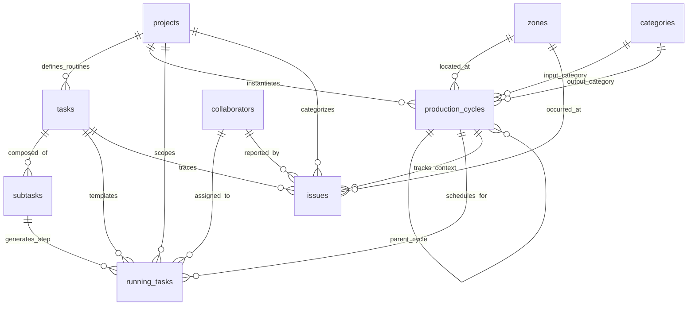

# Thiết Kế Cơ Sở Dữ Liệu Vận Hành & Quy Trình Nông Nghiệp (Operation Database Architecture)

Tài liệu đặc tả kiến trúc cơ sở dữ liệu vận hành sản xuất (Standard Operating Procedure - SOP Engine) cho hệ thống trợ lý ảo nông nghiệp **AgriVoice-AI**. Hệ thống được thiết kế để chuẩn hóa quy trình canh tác/chăn nuôi lặp lại, tự động tính toán lịch trình sinh học, điều phối khóa tài nguyên thực địa và quản lý sự cố phát sinh.

> **Quy ước nhất quán về đối tượng sản phẩm**: Hệ thống **loại bỏ hoàn toàn bảng `products` độc lập**. Toàn bộ danh mục đối tượng đầu vào (giống cây con, phân bón, thức ăn) và sản phẩm đầu ra (nông sản thu hoạch, phụ phẩm) được **tái sử dụng trực tiếp từ bảng phân cấp `categories`** được đặc tả tại [Inventory database structure.md](./Inventory%20database%20structure.md).

---

## 1. Bối cảnh & Thách thức vận hành nông nghiệp (Operational Context & Challenges)

### 1.1. Chu kỳ sinh học và tính dung sai (Biological Tolerance)
Trong nông nghiệp, các tác vụ chăm sóc (tưới nước, bón thúc, tiêm vaccine, đảo đệm lót sinh học) tuân theo nhịp sinh học nhưng không hoàn toàn cứng nhắc như dây chuyền công nghiệp:
- Một số công việc có thể xê dịch hoặc bỏ qua vài cữ mà không gây tổn hại nghiêm trọng (ví dụ: làm cỏ có thể hoãn khi trời mưa).
- Ngược lại, có những công việc bắt buộc phải đạt đủ số lần tối thiểu để đảm bảo năng suất, và không được vượt quá số lần tối đa nhằm tránh ngộ độc phân bón/kháng thuốc.

### 1.2. Mâu thuẫn giữa Quy trình mẫu (Template) và Thực thi thực địa (Execution)
- **Quy trình chuẩn (SOP Template)**: Được thiết kế ở mức trừu tượng, định nghĩa các bước theo mốc thời gian tương đối tính từ ngày bắt đầu vụ mùa.
- **Thực tế vận hành (Running Instances)**: Cần ngày giờ thực tế cụ thể, phụ thuộc vào thời điểm xuống giống hoặc thả lứa nuôi. Hệ thống phải tự động ánh xạ từ quy trình mẫu sang lịch công việc chi tiết hàng ngày mà không đòi hỏi thao tác thủ công từ chủ trang trại.

### 1.3. Ràng buộc không gian và Xung đột tài nguyên (Resource Contention & Safety Locks)
Các công việc canh tác thường chia sẻ cùng đối tượng tác động (chuồng trại, ao nuôi, cây trồng, thiết bị máy móc):
- Nếu hai công việc tác động lên cùng một đối tượng cùng lúc (ví dụ: vừa phun thuốc trừ sâu vừa thu hoạch trái), sẽ gây nguy hiểm nghiêm trọng đến an toàn vệ sinh thực phẩm và sức khỏe nhân công.
- Cần cơ chế khóa phân tầng: khóa nội bộ trong cùng quy trình (**Local Lock**) và khóa toàn cục liên quy trình (**Global Lock**).

### 1.4. Phân định rõ ràng: Công việc định kỳ (Routine Tasks) vs Sự cố đột xuất (Unplanned Issues)
- **Task/Sub-task**: Chỉ dành cho các công việc lặp lại có chu kỳ theo kế hoạch (hàng ngày, hàng tuần, định kỳ theo lứa/mùa).
- **Issue**: Dành riêng cho các bất thường, biến động thiên tai, dịch bệnh, hỏng hóc phát sinh ngoài dự kiến và cần xử lý dứt điểm.

---

## 2. Các nguyên lý & Công thức toán học cốt lõi (Core Principles & Mathematical Formulas)

### 2.1. Công thức lập lịch chu kỳ tuyến tính theo thời gian

Mọi chu kỳ sản xuất (`Cycle`) thiết lập một mốc thời gian cơ sở $t_{\text{base}}$ (thường là thời điểm bắt đầu xuống giống hoặc thả giống: `created_at` hoặc `start_date`).

Các tham số thời gian trong một tác vụ định kỳ (`Task`):
- $\text{delay}$: Khoảng thời gian chờ từ $t_{\text{base}}$ đến thời điểm tác vụ bắt đầu được phép kích hoạt lần đầu.
- $\text{last}$: Khoảng thời gian từ $t_{\text{base}}$ đến thời điểm tác vụ kết thúc hoàn toàn trong chu kỳ.
- $\Delta t$ (`time_delta`): Chu kỳ lặp lại của tác vụ (ví dụ: 1 ngày, 3 ngày, 7 ngày).

Các mốc thời gian được tính toán như sau:

$$\text{first\_active} = t_{\text{base}} + \text{delay}$$

$$\text{last\_active} = t_{\text{base}} + \text{last}$$

Thời điểm kích hoạt thực tế kế tiếp tính từ thời điểm hiện tại $t_{\text{now}}$:

$$t_{\text{next}} = \text{first\_active} + \left\lceil \frac{t_{\text{now}} - \text{first\_active}}{\Delta t} \right\rceil \times \Delta t$$

Tổng số lần thực hiện dự kiến trong toàn bộ chu kỳ:

$$N_{\text{expected}} = \left\lfloor \frac{\text{last} - \text{delay}}{\Delta t} \right\rfloor$$

---

### 2.2. Kiểm soát tuân thủ & Dung sai sinh học (Compliance & Skip Ratios)

Để đánh giá mức độ tuân thủ quy trình của người làm vườn mà vẫn bảo đảm tính mềm dẻo:
- $\text{min\_repeats\_ratio} \in [0.0, 1.0]$: Tỉ lệ thực hiện tối thiểu chấp nhận được.
- $\text{max\_repeats\_ratio} \ge 1.0$: Tỉ lệ thực hiện tối đa cho phép (ngăn ngừa lạm dụng thuốc/phân bón).

Số lần thực hiện tối thiểu bắt buộc:

$$N_{\text{min}} = \left\lceil N_{\text{expected}} \times \text{min\_repeats\_ratio} \right\rceil$$

Số lần thực hiện tối đa không được vượt quá:

$$N_{\text{max}} = \left\lfloor N_{\text{expected}} \times \text{max\_repeats\_ratio} \right\rfloor$$

Số lần được phép bỏ qua tối đa:

$$N_{\text{allowed\_skips}} = N_{\text{expected}} - N_{\text{min}} = \left\lfloor N_{\text{expected}} \times (1 - \text{min\_repeats\_ratio}) \right\rfloor$$

---

### 2.3. Cửa sổ bắt đầu thực hiện (Execution Start Window)

Mỗi công việc cụ thể không nên cố định một phút giây chính xác, mà có khoảng thời gian tối ưu để bắt đầu:
- $\text{open\_at}$: Thời điểm sớm nhất trong ngày/chu kỳ được phép bắt đầu công việc.
- $\text{close\_at}$: Thời điểm muộn nhất được phép bắt đầu công việc.
- $\text{duration}$: Thời lượng ước tính để hoàn thành công việc sau khi bắt đầu.

$$\text{Thời điểm bắt đầu hợp lệ} \in [\text{open\_at}, \text{close\_at}]$$

*Ví dụ:* Tưới nước sáng có $\text{open\_at} = \text{05:00}$, $\text{close\_at} = \text{08:00}$, $\text{duration} = 30\text{ phút}$. Người làm vườn có thể bắt đầu lúc 06:15 và kết thúc lúc 06:45.

---

### 2.4. Cơ chế khóa tài nguyên hai cấp độ (Local & Global Safety Locks)

Để bảo đảm an toàn sinh học và tránh xung đột thiết bị/nhân lực trên cùng đối tượng chịu tác động (`target_ids`):

1. **Local Lock (`lock = 1`)**:
   - Khi một sub-task đang thực thi trên đối tượng $T$, tất cả các sub-task khác **trong cùng Task quy trình** liên quan đến $T$ bị chặn kích hoạt.
2. **Global Lock (`glock = 1`)**:
   - Khi một sub-task đang thực thi trên đối tượng $T$, tất cả các sub-task thuộc **bất kỳ Task hoặc Quy trình nào khác** liên quan đến $T$ đều bị chặn triệt để (ví dụ: đang phun thuốc khử trùng chuồng thì không cho phép sub-task cho ăn từ quy trình chăn nuôi chạy đồng thời).

---

## 3. Chi tiết lược đồ cơ sở dữ liệu (Data Schema Specification)

### 3.1. Dự án / Mảng sản xuất kinh doanh (`projects`)
Bảng đỉnh cấp định nghĩa các tuyến sản xuất hoặc mô hình kinh doanh dài hạn. AI sử dụng bảng này để nắm bắt ngữ cảnh phân loại cấp cao.

| Tên cột | Kiểu dữ liệu | Ràng buộc | Mục đích & Ý nghĩa |
| :--- | :--- | :--- | :--- |
| `project_id` | `INTEGER` | `PRIMARY KEY AUTOINCREMENT` | Khóa chính định danh dự án. |
| `code` | `TEXT` | `NOT NULL UNIQUE` | Mã dự án ngắn gọn (ví dụ: `PRJ_CHICKEN`, `PRJ_BANANA`). |
| `name` | `TEXT` | `NOT NULL` | Tên dự án (ví dụ: *Nuôi gà thả vườn*, *Trồng chuối tiêu hồng*, *Chế biến gà ủ muối*). |
| `description` | `TEXT` | `NULL` | Mô tả mục tiêu, tiêu chuẩn chất lượng (hộ gia đình, VietGAP, hữu cơ). |
| `is_active` | `INTEGER` | `NOT NULL DEFAULT 1 CHECK (is_active IN (0, 1))` | Trạng thái dự án (1: đang duy trì hoạt động, 0: tạm dừng/đóng). |
| `created_at` | `TEXT` | `NOT NULL DEFAULT CURRENT_TIMESTAMP` | Thời điểm khởi tạo. |
| `updated_at` | `TEXT` | `NOT NULL DEFAULT CURRENT_TIMESTAMP` | Thời điểm cập nhật cuối cùng. |

---

### 3.2. Quy trình công việc định kỳ (`tasks`)
Định nghĩa các bước công việc lặp lại theo nhịp sinh học gắn liền với quy trình chuẩn của từng dự án.

| Tên cột | Kiểu dữ liệu | Ràng buộc | Mục đích & Ý nghĩa |
| :--- | :--- | :--- | :--- |
| `task_id` | `INTEGER` | `PRIMARY KEY AUTOINCREMENT` | Khóa chính định danh tác vụ chuẩn. |
| `project_id` | `INTEGER` | `NOT NULL REFERENCES projects(project_id) ON DELETE CASCADE` | Thuộc về dự án/mảng sản xuất nào. |
| `name` | `TEXT` | `NOT NULL` | Tên tác vụ (ví dụ: *Vệ sinh chuồng*, *Cho ăn cữ sáng*, *Tiêm vaccine Gumboro đợt 1*). |
| `description` | `TEXT` | `NULL` | Hướng dẫn kỹ thuật và lưu ý khi thực hiện. |
| `time_delta` | `TEXT` | `NOT NULL` | Chu kỳ lặp lại (định dạng khoảng thời gian, ví dụ: `1 day`, `7 days`, `1 month`). |
| `delay` | `TEXT` | `NOT NULL DEFAULT '0 days'` | Độ trễ bắt đầu tính từ $t_{\text{base}}$ của vụ mùa (ví dụ: `14 days` sau khi thả gà con). |
| `last` | `TEXT` | `NOT NULL` | Giới hạn kết thúc tính từ $t_{\text{base}}$ (ví dụ: `90 days` xuất chuồng). |
| `min_repeats_ratio`| `REAL` | `NOT NULL DEFAULT 0.8 CHECK (min_repeats_ratio BETWEEN 0.0 AND 1.0)` | Tỉ lệ hoàn thành tối thiểu chấp nhận được (ví dụ: $0.8 = 80\%$). |
| `max_repeats_ratio`| `REAL` | `NOT NULL DEFAULT 1.2 CHECK (max_repeats_ratio >= 1.0)` | Tỉ lệ hoàn thành tối đa cho phép (ví dụ: $1.2 = 120\%$). |
| `is_active` | `INTEGER` | `NOT NULL DEFAULT 1 CHECK (is_active IN (0, 1))` | Trạng thái kích hoạt trong quy trình. |
| `updated_at` | `TEXT` | `NOT NULL DEFAULT CURRENT_TIMESTAMP` | Thời điểm cập nhật cuối cùng. |

---

### 3.3. Hạng mục con chi tiết & Ràng buộc tài nguyên (`subtasks`)
Chia nhỏ một tác vụ lớn thành các bước thao tác cụ thể, quy định khung giờ, thứ tự tuần tự và cơ chế khóa an toàn.

| Tên cột | Kiểu dữ liệu | Ràng buộc | Mục đích & Ý nghĩa |
| :--- | :--- | :--- | :--- |
| `subtask_id` | `INTEGER` | `PRIMARY KEY AUTOINCREMENT` | Khóa chính định danh hạng mục con. |
| `task_id` | `INTEGER` | `NOT NULL REFERENCES tasks(task_id) ON DELETE CASCADE` | Thuộc về tác vụ mẫu nào. |
| `project_id` | `INTEGER` | `NOT NULL REFERENCES projects(project_id) ON DELETE CASCADE` | Dự án liên đới (hỗ trợ truy vấn nhanh không cần join). |
| `name` | `TEXT` | `NOT NULL` | Tên bước cụ thể (ví dụ: *Rải vôi bột khử trùng*, *Cắt nước 2 giờ trước khi uống thuốc*). |
| `description` | `TEXT` | `NULL` | Thao tác chi tiết, định lượng thuốc hoặc quy chuẩn. |
| `open_at` | `TEXT` | `NOT NULL` | Giờ sớm nhất được phép bắt đầu (ví dụ: `05:00:00` hoặc khoảng cách offset tính từ 00:00). |
| `close_at` | `TEXT` | `NOT NULL` | Giờ muộn nhất được phép bắt đầu (ví dụ: `08:00:00`). |
| `duration_minutes` | `INTEGER` | `NOT NULL DEFAULT 30 CHECK (duration_minutes > 0)` | Thời lượng thực hiện ước tính (phút). |
| `sort_order` | `INTEGER` | `NOT NULL DEFAULT 0` | Thứ tự thực hiện tuần tự giữa các bước của cùng một task. |
| `target_ids` | `TEXT` | `NOT NULL DEFAULT '[]'` | Mảng JSON chứa ID các đối tượng chịu tác động (chuồng, luống, ao, máy móc). |
| `lock` | `INTEGER` | `NOT NULL DEFAULT 0 CHECK (lock IN (0, 1))` | Khóa nội bộ (1: cấm chạy đồng thời các subtask cùng task trên cùng target). |
| `glock` | `INTEGER` | `NOT NULL DEFAULT 0 CHECK (glock IN (0, 1))` | Khóa toàn cục (1: cấm tất cả các subtask liên task/quy trình trên cùng target). |
| `is_active` | `INTEGER` | `NOT NULL DEFAULT 1 CHECK (is_active IN (0, 1))` | Trạng thái hiệu lực. |
| `updated_at` | `TEXT` | `NOT NULL DEFAULT CURRENT_TIMESTAMP` | Thời điểm cập nhật cuối cùng. |

---

### 3.4. Chu kỳ sản xuất & Kinh tế tuần hoàn (`production_cycles`)
Đại diện cho một đợt nuôi trồng, vụ mùa cụ thể trên thực địa, hiện thực hóa quy trình từ `projects`. Hỗ trợ liên kết cha-con phục vụ mô hình **kinh tế tuần hoàn** (Circular Bioeconomy).

> **Tham chiếu trực tiếp `categories`**: Đầu vào (`input_category_id`) và đầu ra (`output_category_id`) liên kết trực tiếp với bảng **`categories`** của hệ thống kho (không qua bảng `products` trung gian). Cây danh mục `categories` hỗ trợ phân cấp nhiều tầng (`root_path`) và tên thuận tiện (`convenient_names`) giúp nhận diện cả vật tư thô lẫn thành phẩm chế biến.

| Tên cột | Kiểu dữ liệu | Ràng buộc | Mục đích & Ý nghĩa |
| :--- | :--- | :--- | :--- |
| `cycle_id` | `INTEGER` | `PRIMARY KEY AUTOINCREMENT` | Khóa chính vụ mùa/chu kỳ. |
| `parent_id` | `INTEGER` | `NULL REFERENCES production_cycles(cycle_id) ON DELETE SET NULL` | Chu kỳ cha. Dùng cho mô hình tuần hoàn (ví dụ: chu kỳ ủ phân có chu kỳ cha là nuôi bò; chu kỳ làm gà muối có chu kỳ cha là nuôi gà). |
| `project_id` | `INTEGER` | `NOT NULL REFERENCES projects(project_id) ON DELETE RESTRICT` | Quy trình dự án áp dụng. |
| `zone_id` | `TEXT` | `NOT NULL REFERENCES zones(zone_id) ON DELETE RESTRICT` | Vị trí địa lý triển khai (khu đất, ao, chuồng trại). |
| `name` | `TEXT` | `NOT NULL` | Tên đợt sản xuất (ví dụ: *Lứa gà Đông Tảo Tết 2026*, *Ủ phân bò đợt 3*). |
| `description` | `TEXT` | `NULL` | Ghi chú đặc điểm đợt sản xuất. |
| `created_at` | `TEXT` | `NOT NULL DEFAULT CURRENT_TIMESTAMP` | Mốc thời gian bắt đầu cơ sở ($t_{\text{base}}$). |
| `ended_at` | `TEXT` | `NULL` | Thời điểm kết thúc vụ/lứa trên thực tế. |
| `status` | `TEXT` | `NOT NULL DEFAULT 'ACTIVE' CHECK (status IN ('PLANNED', 'ACTIVE', 'COMPLETED', 'CANCELLED'))` | Trạng thái chu kỳ. |
| `input_category_id`| `INTEGER` | `NULL REFERENCES categories(category_id)` | Nhóm vật tư/con giống đầu vào chính (từ bảng `categories` phân hệ Kho, ví dụ: *Gà giống 1 ngày tuổi*, *Cây giống cam xoàn*). |
| `input_quantity` | `REAL` | `NOT NULL DEFAULT 0.0 CHECK (input_quantity >= 0)` | Khối lượng/số lượng đầu vào (ví dụ: `200.0`). |
| `input_unit` | `TEXT` | `NULL` | Đơn vị đầu vào (ví dụ: `con`, `kg`, `cây`). |
| `area_size` | `REAL` | `NULL CHECK (area_size IS NULL OR area_size > 0)` | Diện tích hoặc quy mô mặt bằng canh tác của vụ (để tính năng suất tấn/ha). |
| `unit_of_size` | `TEXT` | `DEFAULT 'm2'` | Đơn vị diện tích (`m2`, `ha`, `sao`, `cong`). |
| `expected_yield` | `REAL` | `NULL CHECK (expected_yield IS NULL OR expected_yield >= 0)` | Sản lượng kỳ vọng ban đầu theo kế hoạch. |
| `output_category_id`| `INTEGER`| `NULL REFERENCES categories(category_id)` | Nhóm nông sản/thành phẩm đầu ra (từ bảng `categories` phân hệ Kho, ví dụ: *Thịt gà thương phẩm*, *Phân chuồng hoai mục*). |
| `output_quantity` | `REAL` | `NULL CHECK (output_quantity IS NULL OR output_quantity >= 0)` | Sản lượng đầu ra thực thu. |
| `output_unit` | `TEXT` | `NULL` | Đơn vị đầu ra (ví dụ: `kg`, `tấn`). |
| `updated_at` | `TEXT` | `NOT NULL DEFAULT CURRENT_TIMESTAMP` | Thời điểm cập nhật cuối cùng. |

---

### 3.5. Công việc thực thi thực địa (`running_tasks`)
Bao gồm cả các công việc sinh tự động từ quy trình chuẩn (SOP Template) và các công việc giao tức thời bằng giọng nói (**Ad-hoc Tasks**).

| Tên cột | Kiểu dữ liệu | Ràng buộc | Mục đích & Ý nghĩa |
| :--- | :--- | :--- | :--- |
| `running_task_id`| `INTEGER` | `PRIMARY KEY AUTOINCREMENT` | Khóa chính phiên công việc. |
| `cycle_id` | `INTEGER` | `NULL REFERENCES production_cycles(cycle_id) ON DELETE CASCADE` | Thuộc chu kỳ vụ mùa nào (NULL nếu là việc bảo trì chung). |
| `project_id` | `INTEGER` | `NULL REFERENCES projects(project_id) ON DELETE CASCADE` | Dự án liên đới. |
| `task_id` | `INTEGER` | `NULL REFERENCES tasks(task_id) ON DELETE SET NULL` | Tác vụ mẫu gốc (NULL nếu là việc giao tức thời Ad-hoc). |
| `subtask_id` | `INTEGER` | `NULL REFERENCES subtasks(subtask_id) ON DELETE SET NULL` | Bước thao tác cụ thể (NULL nếu là việc giao tức thời Ad-hoc). |
| `assigned_to` | `INTEGER` | `NULL REFERENCES collaborators(collaborator_id)` | Nhân công được chỉ định thực hiện. |
| `name` | `TEXT` | `NOT NULL` | Tên công việc hiển thị (ví dụ: *Tưới nước khu A cữ sáng 15/10*, *Sửa ống nước bị chuột cắn*). |
| `description` | `TEXT` | `NULL` | Nội dung nhắc nhở hoặc yêu cầu kỹ thuật chi tiết. |
| `scheduled_start`| `TEXT` | `NOT NULL` | Thời điểm dự kiến bắt đầu ($[\text{open\_at}, \text{close\_at}]$). |
| `duration_minutes`| `INTEGER` | `NOT NULL DEFAULT 30` | Thời gian làm dự kiến. |
| `status` | `TEXT` | `NOT NULL DEFAULT 'TODO' CHECK (status IN ('TODO', 'IN_PROGRESS', 'DONE', 'SKIPPED', 'CANCELLED'))` | Trạng thái phiên làm việc. |
| `material_category_id`| `INTEGER`| `NULL REFERENCES categories(category_id)` | Vật tư nông nghiệp đã sử dụng khi làm task (ví dụ: *Phân NPK*, *Thuốc rầy*). |
| `quantity_used` | `REAL` | `NULL CHECK (quantity_used IS NULL OR quantity_used > 0)` | Lượng vật tư đã tiêu hao. |
| `material_unit` | `TEXT` | `NULL` | Đơn vị vật tư tiêu hao (`bao`, `chai`, `kg`, `lit`). |
| `inventory_transaction_id`| `INTEGER`| `NULL REFERENCES inventory_transactions(transaction_id) ON DELETE SET NULL` | Phiếu xuất kho tự động sinh ra khi hoàn thành task có dùng vật tư (liên kết Kho). |
| `pending_event_id`| `INTEGER` | `NULL REFERENCES pending_events(event_id) ON DELETE SET NULL` | ID sự kiện In-Flight tương ứng để nghe lại giọng nói báo cáo. |
| `report_complete_at`| `TEXT` | `NULL` | Thời điểm hoàn thành do người làm vườn báo cáo qua giọng nói (Voice log). |
| `completion_notes`| `TEXT` | `NULL` | Ghi chú của nhân công khi hoàn thành (thuốc đã pha, liều lượng, hiện trạng sau khi làm). |
| `created_at` | `TEXT` | `NOT NULL DEFAULT CURRENT_TIMESTAMP` | Thời điểm bản ghi được lên lịch. |
| `updated_at` | `TEXT` | `NOT NULL DEFAULT CURRENT_TIMESTAMP` | Thời điểm cập nhật. |
---

### 3.6. Sổ quản lý sự cố & Bất thường hiện trường (`issues`)
Ghi nhận các vấn đề đột xuất, hỏng hóc hoặc dịch bệnh cần xử lý ngay, nằm ngoài lịch trình của quy trình định kỳ.

| Tên cột | Kiểu dữ liệu | Ràng buộc | Mục đích & Ý nghĩa |
| :--- | :--- | :--- | :--- |
| `issue_id` | `INTEGER` | `PRIMARY KEY AUTOINCREMENT` | Khóa chính định danh sự cố. |
| `title` | `TEXT` | `NOT NULL` | Tóm tắt sự cố (ví dụ: *Bơm tưới khu B chập điện*, *Rầy mềm bám lá non vườn cam*). |
| `description` | `TEXT` | `NULL` | Mô tả triệu chứng, phạm vi ảnh hưởng chi tiết. |
| `zone_id` | `TEXT` | `NOT NULL REFERENCES zones(zone_id) ON DELETE RESTRICT` | Khu vực phát sinh sự cố. |
| `cycle_id` | `INTEGER` | `NULL REFERENCES production_cycles(cycle_id) ON DELETE SET NULL` | Liên kết chu kỳ mùa vụ (dùng thống kê rủi ro mùa vụ). |
| `project_id` | `INTEGER` | `NULL REFERENCES projects(project_id) ON DELETE SET NULL` | Liên kết dự án để đánh giá rủi ro theo loại hình SXKD. |
| `task_id` | `INTEGER` | `NULL REFERENCES tasks(task_id) ON DELETE SET NULL` | Bước quy trình liên đới (nếu sự cố bắt nguồn từ việc làm sai quy trình). |
| `severity` | `TEXT` | `NOT NULL DEFAULT 'MEDIUM' CHECK (severity IN ('LOW', 'MEDIUM', 'HIGH', 'CRITICAL'))` | Mức độ nghiêm trọng. |
| `status` | `TEXT` | `NOT NULL DEFAULT 'OPEN' CHECK (status IN ('OPEN', 'IN_PROGRESS', 'RESOLVED', 'CLOSED'))` | Tiến độ xử lý sự cố. |
| `reported_by` | `TEXT` | `NOT NULL DEFAULT 'Bác giữ vườn'` | Tên/Nguồn phát hiện sự cố. |
| `reporter_id` | `INTEGER` | `NULL REFERENCES collaborators(collaborator_id)` | Nhân sự báo cáo. |
| `resolution_notes`| `TEXT` | `NULL` | Phương án đã xử lý và kết quả nghiệm thu. |
| `notes` | `TEXT` | `NULL` | Nhật ký cập nhật tiến trình khắc phục. |
| `created_at` | `TEXT` | `NOT NULL DEFAULT CURRENT_TIMESTAMP` | Thời điểm phát hiện sự cố. |
| `updated_at` | `TEXT` | `NOT NULL DEFAULT CURRENT_TIMESTAMP` | Thời điểm cập nhật cuối cùng. |
| `closed_at` | `TEXT` | `NULL` | Thời điểm nghiệm thu đóng sự cố. |
| `pending_event_id`| `INTEGER` | `NULL REFERENCES pending_events(event_id) ON DELETE SET NULL` | ID sự kiện In-Flight tương ứng để nghe lại giọng nói báo cáo sự cố. |

---

### 3.7. Khung nhìn Báo cáo Hiệu suất & Năng suất vụ mùa (`v_cycle_yield_performance`)
Khung nhìn (SQL View) tự động kết xuất chỉ số năng suất (tấn/ha), tỷ lệ hoàn thành mục tiêu sản lượng, và đánh giá hiệu quả sinh học của từng vụ mùa:

```sql
CREATE VIEW IF NOT EXISTS v_cycle_yield_performance AS
SELECT 
    c.cycle_id,
    c.name AS cycle_name,
    c.status AS cycle_status,
    c.start_date,
    c.actual_end_date,
    p.name AS project_name,
    z.name AS zone_name,
    c.area_size,
    c.unit_of_size,
    c.input_quantity,
    c.input_unit,
    c.expected_yield,
    c.output_quantity AS actual_yield,
    c.output_unit,
    -- Nang suat quy doi (kg/m2 hoac tan/ha)
    CASE 
        WHEN c.area_size > 0 AND c.output_quantity IS NOT NULL 
        THEN ROUND(c.output_quantity / c.area_size, 2)
        ELSE NULL 
    END AS yield_per_area_unit,
    -- Ty le dat ke hoach san luong (%)
    CASE 
        WHEN c.expected_yield > 0 AND c.output_quantity IS NOT NULL 
        THEN ROUND((c.output_quantity * 100.0) / c.expected_yield, 1)
        ELSE NULL 
    END AS yield_achievement_rate,
    -- Tong so su co da phat sinh trong vu
    (SELECT COUNT(*) FROM issues i WHERE i.cycle_id = c.cycle_id) AS total_issues_count
FROM production_cycles c
LEFT JOIN projects p ON c.project_id = p.project_id
LEFT JOIN zones z ON c.zone_id = z.zone_id;
```

## 4. Cơ chế vận hành & Luồng điều phối AI (Operational Workflows & AI Interaction)

```
[Quy trình mẫu Tasks & Subtasks]
                 │
                 ▼ (Ánh xạ theo t_base khi tạo mới Cycle)
       [Scheduler Service]
                 │
                 ├──────────────────────────────┐
                 ▼                              ▼
      [Sinh Running Tasks]            [Kiểm tra Khóa Tài Nguyên]
                 │                    (Local Lock & Global Lock)
                 ▼                              │
    [Bác giữ vườn đọc Voice]                     ▼
                 │                     [Ngăn chặn xung đột an toàn]
                 ▼
[Voice Assistant bóc tách Intent]
                 │
        ┌────────┴─────────────────────┐
        ▼                              ▼
 [Báo cáo hoàn thành Task]     [Báo cáo phát sinh Issue]
        │                              │
        ▼                              ▼
[Cập nhật report_complete_at]    [Tạo bản ghi issues mới]
        │                              │
        └──────────────┬───────────────┘
                       ▼
         [Đánh giá chỉ số Tuân thủ]
         (N_min <= Thực tế <= N_max)
```

### 4.1. Khởi tạo chu kỳ và Tự động sinh lịch làm việc
1. **Bước kiểm tra tồn tại & Chống trùng lặp (Deduplication Check)**:
   - Trước khi tạo, AI/System kiểm tra xem tại `zone_id` đã có chu kỳ nào đang `status = 'ACTIVE'` hay chưa:
     * Nếu đã có chu kỳ cùng giống đang chạy: Bổ sung số lượng giống vào chu kỳ hiện tại, không tạo bản ghi mới để tránh nhân đôi lịch trình.
     * Nếu đang có vụ mùa khác chưa dọn tàn dư: Cảnh báo qua Telegram để chủ vườn xác nhận kết thúc vụ cũ trước khi tạo vụ mới.
     * Nếu khu vực trống: Tiến hành khởi tạo an toàn.
2. **Khi chủ vườn ra lệnh hoặc khi nhận giống về**: *"Bắt đầu nuôi lứa 200 con gà Đông Tảo tại chuồng 1 từ hôm nay"*:
   - AI nhận diện `input_category_id` (nhóm *Gà giống Đông Tảo* trong bảng `dictionary`), gán `project_id = PRJ_CHICKEN`, `zone_id = ZONE_CHUONG_1`, $t_{\text{base}} = \text{hôm nay}$, `input_quantity = 200`.
   - Scheduler quét các `tasks` và `subtasks` thuộc `PRJ_CHICKEN`, sử dụng công thức ở mục 2.1 để tạo các `running_tasks` với thời gian cụ thể trải dài trong 90 ngày.
1. Bác giữ vườn nói: *"Đã cho gà chuồng 1 ăn sáng xong rồi"*:
   - AI nhận diện intent `COMPLETE_TASK`, truy vấn bảng `running_tasks` tìm tác vụ có trạng thái `TODO` hoặc `IN_PROGRESS` của `ZONE_CHUONG_1` trong khung giờ hiện tại.
   - Hệ thống cập nhật:
     - `status = 'DONE'`
     - `report_complete_at = CURRENT_TIMESTAMP`

### 4.3. Giám sát tỷ lệ tuân thủ & Cảnh báo bất thường
1. **Thiếu việc (Under-run Alert)**:
   - Nếu số lần hoàn thành thực tế $N_{\text{actual}} < N_{\text{min}}$ khi chu kỳ đã trôi qua $75\%$ thời gian, AI phát thông báo nhắc nhở chủ vườn: *"Lứa gà hiện chỉ mới được tiêu độc khử trùng 4/8 lần dự kiến. Cần tăng cường để tránh dịch bệnh."*
2. **Lạm dụng quá liều (Over-run Violation)**:
   - Nếu nhân công báo hoàn thành thêm một lần phun thuốc bảo vệ thực vật khi $N_{\text{actual}} \ge N_{\text{max}}$, hệ thống ghi nhận nhưng cảnh báo khẩn cấp vì vi phạm an toàn cách ly.

### 4.4. Kiểm tra khóa tài nguyên khi thi công
1. Trước khi chuyển một `running_task` sang `IN_PROGRESS`:
   - Hệ thống kiểm tra các `running_tasks` khác đang chạy trên cùng tập `target_ids`.
   - Nếu có tác vụ đang giữ `glock = 1`, hệ thống từ chối cho phép bắt đầu và thông báo qua bot: *"Không thể thực hiện cho ăn tại Chuồng 1 vì đang trong thời gian cách ly khử trùng vôi bột."*

---

## 5. Sơ đồ quan hệ thực thể (Entity Relationship Diagram)



> **Chú thích liên kết liên phân hệ**:
> - `categories`: Bảng nhóm phân cấp vật tư/sản phẩm được định nghĩa tại phân hệ Kho ([Inventory database structure.md](./Inventory%20database%20structure.md)).
> - `zones`: Bảng phân khu/khu vực canh tác chung toàn hệ thống.
> - `collaborators`: Bảng nhân sự/người làm vườn.

---

## 6. Kết luận & Khuyến nghị kỹ thuật

1. **Thống nhất thực thể hàng hóa bằng `categories`**:
   - Loại bỏ bảng `products` độc lập để tránh trùng lặp dữ liệu và đơn giản hóa mô hình. Toàn bộ đầu vào và đầu ra của chu kỳ canh tác đều là một nút trên cây danh mục phân cấp đa tầng `categories` (`root_path`), cho phép theo dõi dòng chảy vật chất và hạch toán giá trị một cách tự nhiên.
2. **Tách biệt Quy trình mẫu và Dữ liệu vận hành thực tế**:
   - Giữ bảng `tasks` làm khuôn mẫu (blueprint) trừu tượng có tính toán đại số tương đối, và chỉ tạo các thực thể ngày giờ cụ thể trên bảng `running_tasks`.
3. **Ứng dụng công thức tính toán thay cho Cronjob cứng**:
   - Sử dụng công thức $\left\lceil \frac{t_{\text{now}} - \text{first\_active}}{\Delta t} \right\rceil$ giúp truy vấn tác vụ kế tiếp theo thời gian thực ($O(1)$) trên Raspberry Pi mà không cần duy trì các tiến trình background scheduler nặng nề chạy ngầm liên tục.
4. **Mô hình hóa kinh tế tuần hoàn bằng `parent_id`**:
   - Quan hệ tự tham chiếu trên bảng `production_cycles` cho phép liên kết các dòng phụ phẩm (phân gia súc $\rightarrow$ chu kỳ ủ phân $\rightarrow$ bón cho chuối $\rightarrow$ thân chuối làm thức ăn nuôi cá), giúp AI tự động tính toán tổng giá trị kinh tế của toàn bộ hệ sinh thái trang trại.
5. **Bảo toàn dữ liệu bằng nguyên tắc không xóa lịch sử**:
   - Khi một công việc định kỳ không thể thực hiện, đánh dấu trạng thái `SKIPPED` kèm lý do, tuyệt đối không xóa bản ghi để bảo toàn dữ liệu phục vụ báo cáo tuân thủ cuối vụ.
