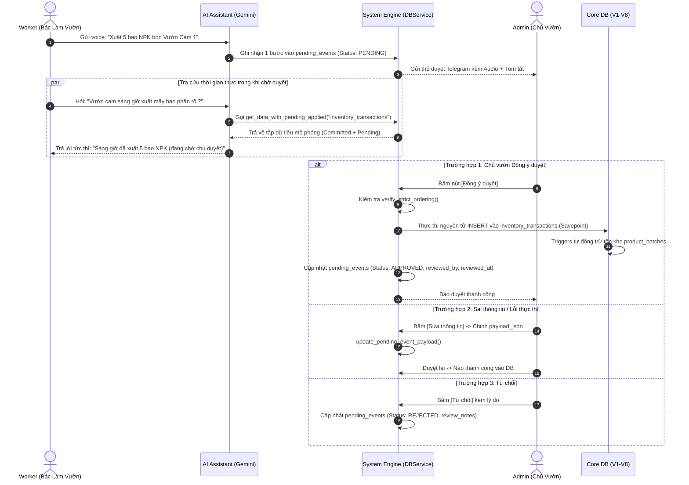

# Đặc Tả Hệ Thống Phương Thức & Luồng Xử Lý (System Methods & Operational Architecture)

Tài liệu đặc tả kiến trúc các phương thức, dịch vụ điều phối (Service Methods), ma trận phân quyền tác tử và luồng tương tác giữa **Nhân công (Worker)**, **Trí tuệ nhân tạo (AI)**, **Hệ thống tự động (System Engine)** và **Chủ trang trại (Admin/Owner)** trong nền tảng **AgriVoice-AI**.

---

## 1. Mô hình Tác nhân & Ma trận Phân quyền (Actors & Responsibility Matrix)

Hệ thống phân định rạch ròi 4 thực thể tham gia vào vòng đời của dữ liệu:

```
┌─────────────────┐       Khẩu lệnh Voice / Báo cáo hiện trường
│ 1. WORKER       │ ────────────────────────────────────────────────────────┐
│ (Bác làm vườn)  │                                                         │
└─────────────────┘                                                         ▼
                                                                  ┌─────────────────┐
                                                                  │ 2. AI ASSISTANT │
                                                                  │ (LLM / Gemini)  │
                                                                  └────────┬────────┘
                                                                           │ Bóc tách, phân loại
                                                                           │ & Schema Validation
                                                                           ▼
┌─────────────────┐      Phê duyệt tuần tự, chỉnh sửa & rà soát   ┌─────────────────┐
│ 4. ADMIN        │ ◄──────────────────────────────────────────── │ 3. SYSTEM       │
│ (Chủ vườn/QL)   │ ────────────────────────────────────────────► │ (In-Flight DB & │
└─────────────────┘      Lệnh thực thi chính thức xuống Core DB   │  Service Core)  │
                                                                  └─────────────────┘
```

### 1.1. Bác giữ vườn / Nhân công (`Worker`)
- **Vai trò**: Tác nghiệp trực tiếp ngoài đồng ruộng, chuồng trại, kho bãi.
- **Phương thức tương tác**: Gửi tin nhắn thoại (Voice note) hoặc khẩu lệnh ngắn qua Telegram Bot.
- **Ranh giới an toàn**:
  - **Không bao giờ có quyền ghi trực tiếp** vào các bảng dữ liệu cốt lõi (Core Database V1–V8).
  - Mọi thay đổi dữ liệu từ Worker bắt buộc phải đi qua sự thông dịch của `AI Assistant` và nằm tại vùng đệm chờ duyệt `pending_events`.

### 1.2. Trợ lý Trí tuệ nhân tạo (`AI Assistant`)
- **Vai trò**: Thông dịch viên ngữ cảnh và bóc tách dữ liệu mờ (Fuzzy Extractor).
- **Trách nhiệm**:
  - Chuyển đổi giọng nói thành văn bản (`raw_transcript`).
  - Bóc tách thực thể, ánh xạ tên gọi dân dã qua từ điển `convenient_names`.
  - Gọi các công cụ đọc (`search_*`) để tự giải quyết các câu hỏi tra cứu tức thì (Read-only Q&A).
  - Đóng gói dữ liệu thay đổi thành đối tượng chuẩn `payload_json` và đẩy vào hàng đợi `pending_events`.
- **Ranh giới an toàn**: AI không có quyền tự động phê duyệt (`APPROVE`) các thay đổi mang tính cốt lõi (tài chính, tăng giảm tồn kho, đóng dự án).

### 1.3. Động cơ Hệ thống tự động (`System Engine`)
- **Vai trò**: Bộ máy vận hành lõi chạy ngầm trên máy chủ nhúng Raspberry Pi.
- **Trách nhiệm**:
  - Quản lý hàng đợi In-Flight và bảo đảm thứ tự thời gian nghiêm ngặt (`Strict Chronological Ordering`).
  - Tự động hóa các Triggers (cập nhật tồn kho theo lô `product_batches`, đóng mốc thời gian `completed_at`, cập nhật `updated_at`).
  - Khởi tạo lịch làm việc chi tiết (`running_tasks`) từ quy trình mẫu khi chu kỳ (`Cycle`) bắt đầu.
  - Cung cấp cơ chế **Lớp phủ ảo thời gian thực (Virtual Pending Overlay)** mô phỏng trạng thái dữ liệu cho AI và báo cáo.

### 1.4. Chủ trang trại / Quản trị viên (`Admin / Owner`)
- **Vai trò**: Người chịu trách nhiệm pháp lý và kinh tế cao nhất của trang trại.
- **Trách nhiệm**:
  - Rà soát, nghe lại file ghi âm, kiểm tra đối chứng số lượng/danh mục trên thẻ duyệt Telegram.
  - Chỉnh sửa `payload_json` nếu AI nghe nhầm trước khi duyệt.
  - Phê duyệt (`APPROVE`), từ chối (`REJECT`) sự kiện hoặc giải quyết các sự cố lỗi (`ERROR`).
  - Thực hiện các thao tác quản trị đặc biệt: đóng/nghiệm thu sự cố (`issues`), kiểm kê kho, can thiệp thủ công các giao dịch.

---

## 2. Luồng Vận Hành Vòng Đời Dữ Liệu (End-to-End Operational Lifecycle)



---

## 3. Phân Loại & Đặc Tả Chi Tiết Các Nhóm Phương Thức (Method Specifications)

### 3.1. Nhóm Phương Thức Thu Nhận & Kiểm Duyệt In-Flight (Staging & Queue Engine)

Vùng đệm kiểm soát an toàn trước khi dữ liệu chạm vào cơ sở dữ liệu chính.

#### 3.1.1. `stage_pending_event(...)`
- **Tác nhân sử dụng**: `AI Assistant`, `Admin`.
- **Mục đích**: Ghi nhận một hành động nghiệp vụ do AI bóc tách vào hàng đợi chờ duyệt `pending_events`.
- **Tham số đầu vào**:
  - `sender_id`: Mã Telegram của người phát ngôn.
  - `target_table`: Bảng nghiệp vụ đích (`inventory_transactions`, `tasks`, `issues`, `financial_transactions`, `barter_transactions`...).
  - `action_type`: `INSERT`, `UPDATE`, `DELETE`, hoặc `UPSERT`.
  - `payload`: Dictionary hoặc JSON string chứa thuộc tính cần nạp.
  - `raw_transcript`: Câu nói nguyên văn của nhân công.
  - `summary_text`: Tóm tắt ngắn gọn hiển thị trên thông báo.
  - `audio_path`: Đường dẫn file `.ogg` gốc trên Raspberry Pi.
  - `timestamp`: Thời điểm phát ngôn thực tế.
- **Quy tắc an toàn**: Ghi trực tiếp 1 bước duy nhất vào `pending_events` (không qua bảng trung gian).

#### 3.1.2. `verify_strict_ordering(event_id)`
- **Tác nhân sử dụng**: `System Engine` (tự động gọi bên trong hàm duyệt).
- **Mục đích**: Bảo đảm trật tự thời gian nhân quả nghiêm ngặt.
- **Logic thực thi**:
  - Truy vấn kiểm tra xem có sự kiện nào khác có trạng thái `PENDING` hoặc `ERROR` phát sinh tại thời điểm sớm hơn ($t_j < t_{\text{event}}$ hoặc cùng thời điểm nhưng $\text{event\_id}_j < \text{event\_id}$) hay không.
  - Nếu có $\implies$ Chặn đứng thao tác duyệt và quăng ngoại lệ `StrictOrderingViolationError`.

#### 3.1.3. `approve_pending_event(event_id, reviewer_id, review_notes)`
- **Tác nhân sử dụng**: `Admin / Owner`.
- **Mục đích**: Phê duyệt sự kiện và nạp chính thức vào bảng đích.
- **Logic thực thi**:
  1. Kiểm tra `verify_strict_ordering`.
  2. Mở `SAVEPOINT apply_pending_event`.
  3. Giải nén `payload_json` và thực thi câu lệnh SQL tương ứng (`INSERT`/`UPDATE`/`DELETE`) lên bảng đích.
  4. Cập nhật `status = 'APPROVED'`, điền `reviewed_by` và ghi nhận `reviewed_at`.
  5. Giải phóng savepoint và commit transaction.
  6. **Cơ chế chịu lỗi**: Nếu câu lệnh SQL tại bước 3 bị lỗi (vi phạm FK, Check, tồn kho âm vượt mức...) $\implies$ Rollback về Savepoint, cập nhật sự kiện sang `status = 'ERROR'` kèm `error_message`, không làm crash hệ thống.

#### 3.1.4. `reject_pending_event(event_id, reviewer_id, review_notes)`
- **Tác nhân sử dụng**: `Admin / Owner`.
- **Mục đích**: Từ chối không tiếp nhận sự kiện.
- **Quy tắc**: Không bao giờ xóa dòng dữ liệu khỏi database. Chỉ cập nhật `status = 'REJECTED'`, lưu lý do vào `review_notes` để bảo toàn vết kiểm toán (Audit Trail).

#### 3.1.5. `update_pending_event_payload(event_id, payload, reset_status_to_pending)`
- **Tác nhân sử dụng**: `Admin / Owner`.
- **Mục đích**: Cho phép chủ vườn chỉnh sửa thông tin bị AI bóc tách sai hoặc sửa lỗi của sự kiện `ERROR` trước khi bấm duyệt lại.

---

### 3.2. Nhóm Phương Thức Vận Hành & Lập Lịch Quy Trình (Operation & SOP Engine)

Quản lý chu kỳ canh tác tuần hoàn, lập lịch tác vụ định kỳ và kiểm soát khóa an toàn.

#### 3.2.1. `build_running_tasks_for_cycle(cycle_id)`
- **Tác nhân sử dụng**: `System Engine` (tự động gọi khi tạo chu kỳ), `Admin` (chạy tái lập lịch).
- **Mục đích**: Chuyển hóa quy trình mẫu trừu tượng (`tasks`, `subtasks`) thành danh sách các phiên công việc thực địa cụ thể (`running_tasks`).
- **Logic tính toán**:
  - Xác định mốc thời gian bắt đầu cơ sở $t_{\text{base}}$ từ `production_cycles.created_at`.
  - Quét toàn bộ `tasks` thuộc `project_id` của chu kỳ.
  - Sử dụng công thức tuyến tính:
    $$\text{first\_active} = t_{\text{base}} + \text{delay}, \quad \text{last\_active} = t_{\text{base}} + \text{last}$$
    $$t_{\text{step}} = \text{first\_active} + k \times \Delta t \quad \left(k = 0, 1, \dots, \left\lfloor \frac{\text{last} - \text{delay}}{\Delta t} \right\rfloor\right)$$
  - Tạo các bản ghi `running_tasks` với thời điểm khuyến nghị $[\text{open\_at}, \text{close\_at}]$ và thời lượng `duration_minutes`.

#### 3.2.2. `create_adhoc_task(...)`
- **Tác nhân sử dụng**: `Worker` (qua Voice), `Admin`.
- **Mục đích**: Giao việc tức thời, đột xuất không theo quy trình mẫu (chiếm 90% đời sống nông hộ).
- **Đặc điểm**: Sinh trực tiếp một dòng trong `running_tasks` với `task_id = NULL`, `subtask_id = NULL`, chỉ cần các thông tin cơ bản: `name`, `assigned_to`, `scheduled_start`, `duration_minutes`.

#### 3.2.3. `complete_running_task(running_task_id, worker_id, material_used, ...)`
- **Tác nhân sử dụng**: `Worker` (báo cáo qua Voice), `Admin`.
- **Mục đích**: Báo cáo hoàn thành một phiên công việc.
- **Cơ chế liên kết Kho tự động (Auto Material Depletion)**:
  - Cập nhật `status = 'DONE'`, ghi nhận `report_complete_at = CURRENT_TIMESTAMP`.
  - Nếu công việc có khai báo sử dụng vật tư (`material_category_id`, `quantity_used`):
    - Tự động sinh một phiếu xuất kho `ISSUE` trên bảng `inventory_transactions`.
    - Trỏ liên kết khóa ngoại `inventory_transaction_id` ngược lại `running_tasks`.
    - Giúp người làm vườn chỉ cần nói 1 lần: *"Đã bón xong 2 bao NPK"* là hệ thống tự động hoàn thành task và trừ kho cùng lúc.

#### 3.2.4. `check_resource_locks(target_ids, running_task_id)`
- **Tác nhân sử dụng**: `System Engine`.
- **Mục đích**: Ngăn ngừa xung đột tác động đồng thời trên cùng đối tượng (chuồng, ao, lô đất).
- **Quy tắc khóa**:
  - **Local Lock (`lock = 1`)**: Chặn các subtask khác trong cùng Task quy trình.
  - **Global Lock (`glock = 1`)**: Chặn toàn bộ tất cả các tác vụ khác trong toàn trang trại tác động lên `target_ids` đó (ví dụ: đang cách ly phun thuốc khử trùng thì cấm toàn bộ việc cho ăn hay làm cỏ).

#### 3.2.5. `manage_issue(issue_id, action, ...)`
- **Tác nhân sử dụng**:
  - Tạo issue mới: `Worker` (qua Voice), `AI Assistant`, `Admin`.
  - Cập nhật ghi chú `notes`: `Worker`, `Admin`.
  - **Chỉ duy nhất `Admin`** có thẩm quyền đổi trạng thái sang `RESOLVED` hoặc `CLOSED` sau khi đã nghiệm thu hiện trường thực tế.

---

### 3.3. Nhóm Phương Thức Kho Vận, Lô Hàng & Dung Sai Âm (Inventory Engine)

Quản lý dịch chuyển vật tư, dung sai âm thực tế và quy đổi đơn vị linh hoạt.

#### 3.3.1. `record_inventory_transaction(...)`
- **Tác nhân sử dụng**: `System Engine` (khi duyệt event), `Admin`.
- **Mục đích**: Ghi nhận biến động xuất nhập kho chính thức.
- **Đặc tính kỹ thuật**:
  - Tự động tính số lượng chuẩn cơ sở: $\text{quantity\_base} = \text{quantity\_change} \times \text{factor\_to\_base}$ thông qua bảng `category_unit_conversions`.
  - **Tính bất biến (Immutable Ledger)**: Khi trạng thái là `POSTED`, trigger chặn tuyệt đối các lệnh `UPDATE` hoặc `DELETE`. Mọi hiệu chỉnh đều phải thực hiện bằng phiếu bù trừ `ADJUSTMENT`.

#### 3.3.2. `reconcile_batches_and_stock(batch_id, ...)`
- **Tác nhân sử dụng**: `System Engine` (tự động qua Trigger), `Admin` (rà soát).
- **Cơ chế xử lý tồn kho âm (Negative Stock Tolerance)**:
  - Khi xuất hàng trước khi nhập: Hệ thống tự động tạo lô ảo (`is_virtual = 1`, `status = 'NEGATIVE_ALERT'`).
  - Lô hàng được phép nhận giá trị âm: $\text{quantity\_remaining} < 0$.
  - Khi phiếu nhập kho thực tế được duyệt sau đó: Hệ thống tự động cấn trừ số dư âm, đưa trạng thái về `AVAILABLE` hoặc `DEPLETED`.

#### 3.3.3. `upsert_inventory_metadata(...)`
- **Tác nhân sử dụng**: `Admin`, `System Engine`.
- **Mục đích**: Cập nhật từ điển hệ thống:
  - `dictionary`: Thêm nhóm vật tư, nông sản hoặc điểm lưu trữ/kho bãi (`root_path`), cập nhật `convenient_names`.
  - `category_unit_conversions`: Cấu hình tỷ lệ đổi đơn vị dân dã (1 bao = 50 kg, 1 bình = 16 lít).
  - `zones`, `suppliers`: Cập nhật thông tin đối tác, khu vực canh tác và bí danh `convenient_names`.
---

### 3.4. Nhóm Phương Thức Tài Chính, Công Nợ & Hàng-Đổi-Hàng (Financial & Barter Engine)

Quản lý dòng tiền số nguyên tuyệt đối, công nợ hai chiều và nghiệp vụ trao đổi hàng hóa.

#### 3.4.1. `record_financial_transaction(...)`
- **Tác nhân sử dụng**: `System Engine` (khi duyệt event), `Admin`.
- **Mục đích**: Ghi nhận phát sinh thu/chi tiền mặt hoặc chuyển khoản.
- **Ràng buộc chuẩn hóa**: Số tiền `amount` bắt buộc là số nguyên dương (`INTEGER` VND), không dùng số thực để tránh sai lệch làm tròn. Tự động liên kết `cycle_id` để hạch toán giá thành vụ mùa.

#### 3.4.2. `record_barter_exchange(...)`
- **Tác nhân sử dụng**: `System Engine` (khi duyệt event), `Admin`.
- **Mục đích**: Thực thi giao dịch trao đổi hàng hóa trực tiếp phi tiền tệ.
- **Cơ chế đồng bộ hai vế nguyên tử (Dual-Leg Atomic Sync)**:
  - Bọc toàn bộ trong 1 transaction:
    1. Tạo phiếu xuất kho `ISSUE` cho hàng đem đổi (`give_category_id`, `give_quantity`).
    2. Tạo phiếu nhập kho `RECEIPT` cho hàng nhận về (`receive_category_id`, `receive_quantity`).
    3. Tạo bản ghi đối ứng `barter_transactions` lưu vết chênh lệch `cash_difference_vnd`.
    4. Nếu có bù tiền mặt ($\Delta_{\text{cash}} \neq 0$): Tạo giao dịch tài chính đối ứng trong `financial_transactions`.

#### 3.4.3. `process_debt_payment(debt_id, amount_paid, payment_method, ...)`
- **Tác nhân sử dụng**: `System Engine` (khi duyệt event trả nợ), `Admin`.
- **Mục đích**: Ghi nhận thanh toán trả nợ từng lần cho một khoản nợ lớn.
- **Logic cập nhật**:
  - Ghi bản ghi vào `debt_payments`.
  - Tạo giao dịch tài chính `financial_transactions` ghi nhận dòng tiền ra/vào.
  - Tự động cộng dồn `paid_amount` trong `debt_records`.
  - Cột ảo `remaining_amount` tự động giảm. Khi về $0 \implies$ tự động đổi trạng thái sang `SETTLED`.

---

### 3.5. Nhóm Phương Thức Tra Cứu, Tìm Kiếm & Lớp Phủ Ảo (Query, Search & Virtual Overlay)

Cung cấp dữ liệu hợp nhất cho AI và các báo cáo quản trị.

#### 3.5.1. `get_data_with_pending_applied(table, conditions, limit, order_by, as_list)`
- **Tác nhân sử dụng**: `AI Assistant`, `System Engine`, `Admin`.
- **Mục đích**: Trả về dữ liệu sạch phản ánh trạng thái thực tế mới nhất của trang trại (kết hợp dữ liệu đã duyệt + các sự kiện pending chưa duyệt).
- **Thuật toán mô phỏng SQL trên RAM (In-Memory SQL Simulation)**:
  1. Đọc dữ liệu cam kết từ bảng đích (`Committed Data`).
  2. Quét hàng đợi `v_pending_events_queue` của bảng đó theo thứ tự `timestamp ASC, event_id ASC`.
  3. Lần lượt áp dụng tuần tự:
     - `INSERT`: Gán khóa chính tạm thời, điền giá trị mặc định, nối vào danh sách.
     - `UPDATE`: Tìm dòng khớp điều kiện `where` hoặc khóa chính, ghi đè thuộc tính mới.
     - `DELETE`: Lọc loại bỏ dòng khớp điều kiện `where`.
  4. Lọc theo `conditions`, sắp xếp theo `order_by` và giới hạn `limit`.
  5. Trả về cấu trúc JSON gọn gàng nạp thẳng vào context của LLM:
     ```json
     {
       "target_table": "issues",
       "committed_count": 5,
       "pending_count": 2,
       "applied_pending_count": 2,
       "committed_data": [ ... ]
     }
     ```

#### 3.5.2. Bộ công cụ Tìm kiếm Chuyên biệt (`search_*` Tools)
- **Tác nhân sử dụng**: `AI Assistant` (qua Function Calling), `Admin`.
- **Danh sách 17 công cụ chuẩn hóa**:
  1. `search_zone`: Tìm kiếm khu vực, lô đất, nhà màng, chuồng trại.
  2. `search_category` / `search_dictionary`: Tra cứu từ điển nhóm vật tư, nông sản hoặc kho bãi.
  3. `search_unit`: Tra cứu đơn vị tính chuẩn và ký hiệu.
  4. `search_supplier`: Tra cứu thông tin, địa chỉ, số điện thoại đại lý.
  5. `search_warehouse`: Tra cứu kho hàng, điểm lưu trữ thực địa (nhánh `/kho/` trong từ điển).
  6. `search_product`: Tra cứu từ điển vật tư, phân bón, giống cây.
  7. `search_task`: Tra cứu tác vụ quy trình mẫu và hạn chót.
  8. `search_subtask`: Tra cứu các bước thao tác cụ thể.
  9. `search_running_task`: Tra cứu phiên công việc thực địa hôm nay.
  10. `search_production_cycle`: Tra cứu thông tin lứa nuôi, vụ mùa đang diễn ra.
  11. `search_production_log`: Tra cứu lịch sử nhật ký chăm sóc, bón phân, tưới nước.
  12. `search_harvest`: Tra cứu các đợt thu hoạch và sản lượng.
  13. `search_inventory_transaction`: Tra cứu lịch sử nhập xuất biến động kho.
  14. `search_financial_transaction`: Tra cứu sổ thu chi tài chính thực tế.
  15. `search_barter_transaction`: Tra cứu lịch sử trao đổi hàng hóa trực tiếp.
  16. `search_debt_record`: Tra cứu số dư công nợ phải thu và phải trả.
  17. `search_collaborator`: Tra cứu danh sách nhân sự, người làm vườn.
---

## 4. Ma Trận Ánh Xạ Phương Thức theo Tác Nhân (Actor-to-Method Access Matrix)

Bảng tổng hợp quyền hạn gọi thực thi các nhóm phương thức trong toàn hệ thống:

| Tên nhóm phương thức / Thao tác | Worker (Khẩu lệnh Voice) | AI Assistant (Tự động hóa) | System Engine (Nền tảng) | Admin / Owner (Chủ trang trại) |
| :--- | :---: | :---: | :---: | :---: |
| **Gửi file âm thanh voice note** | **Toàn quyền** | Không | Không | Cho phép |
| **Tạo sự kiện chờ duyệt (`stage_pending_event`)** | Gián tiếp (qua AI) | **Toàn quyền** | Cho phép | Cho phép |
| **Phê duyệt sự kiện (`approve_pending_event`)** | Bị cấm | Bị cấm | Tự động (nếu cấu hình) | **Toàn quyền (Duy nhất)** |
| **Từ chối sự kiện (`reject_pending_event`)** | Bị cấm | Bị cấm | Không | **Toàn quyền (Duy nhất)** |
| **Chỉnh sửa payload chờ duyệt (`update_payload`)**| Bị cấm | Bị cấm | Không | **Toàn quyền** |
| **Lập lịch chạy vụ mùa (`build_running_tasks`)** | Bị cấm | Bị cấm | **Tự động** | Cho phép chạy lại |
| **Tạo việc giao nhanh (`create_adhoc_task`)** | Gián tiếp (qua AI) | Cho phép | Không | **Toàn quyền** |
| **Báo hoàn thành việc (`complete_running_task`)**| **Khẩu lệnh Voice** | Gián tiếp | Tự động trừ kho | **Toàn quyền** |
| **Mở sự cố mới (`create_issue`)** | **Khẩu lệnh Voice** | Cho phép | Tự động cảnh báo | **Toàn quyền** |
| **Đóng / Nghiệm thu sự cố (`close_issue`)** | Bị cấm | Bị cấm | Không | **Toàn quyền (Duy nhất)** |
| **Ghi sổ kho bất biến (`inventory_transactions`)**| Bị cấm | Bị cấm | Tự động (khi duyệt) | Cho phép (phiếu bù trừ) |
| **Đổi hàng trực tiếp (`record_barter_exchange`)** | Gián tiếp (qua AI) | Gián tiếp | Tự động (khi duyệt) | **Toàn quyền** |
| **Thanh toán nợ (`process_debt_payment`)** | Gián tiếp (qua AI) | Gián tiếp | Tự động (khi duyệt) | **Toàn quyền** |
| **Đọc dữ liệu hợp nhất (`virtual_overlay`)** | Gián tiếp (qua bot) | **Toàn quyền** | **Toàn quyền** | **Toàn quyền** |
| **Tra cứu chuyên biệt (`search_*`)** | Gián tiếp (qua bot) | **Toàn quyền** | **Toàn quyền** | **Toàn quyền** |

---

## 5. Cơ Chế Thích Ứng Dữ Liệu Mờ & Rà Soát Khắc Phục (Fuzzy Tolerance & Safety Nets)

Hệ thống được thiết kế dựa trên triết lý: **"Chấp nhận khẩu lệnh mờ ở đầu vào $\rightarrow$ Hệ thống tự chuẩn hóa $\rightarrow$ Cung cấp công cụ rà soát đối soát đa tầng."**

```
                     ┌───────────────────────────────────────────┐
                     │ KHẨU LỆNH MỜ / THIẾU DỮ LIỆU BAN ĐẦU      │
                     │ (Quên giá, quên kho, nói đơn vị dân dã...)│
                     └─────────────────────┬─────────────────────┘
                                           │
                                           ▼
                     ┌───────────────────────────────────────────┐
                     │ BÙ ĐẮP TỰ ĐỘNG THÔNG MINH BỞI AI & SYSTEM │
                     │ - Thiếu giá  -> Gán đơn giá tham khảo     │
                     │ - Đơn vị mờ -> Quy đổi factor_to_base     │
                     │ - Xuất trước -> Tạo lô ảo tồn âm          │
                     └─────────────────────┬─────────────────────┘
                                           │
                                           ▼
┌─────────────────────────────────────────────────────────────────────────────────────────┐
│                           HỆ THỐNG RÀ SOÁT ĐA TẦNG (SAFETY NETS)                        │
├─────────────────────────────────────────────────────────────────────────────────────────┤
│ TẦNG 1: Trước duyệt (In-Flight Inspection)                                              │
│ - Chủ vườn nghe lại file .ogg gốc và chỉnh sửa payload trực tiếp trên Telegram          │
├─────────────────────────────────────────────────────────────────────────────────────────┤
│ TẦNG 2: Tự động bắt lỗi thực thi (Atomic Savepoint Rollback)                            │
│ - Gặp lỗi ràng buộc -> Đưa về status='ERROR', ghi nhận error_message để chủ vườn sửa lại│
├─────────────────────────────────────────────────────────────────────────────────────────┤
│ TẦNG 3: Đối soát sau ghi sổ qua 4 Khung nhìn tổng hợp (Reconciliation Views)            │
│ 1. v_inventory_root_summary   -> Rà soát lệch nhóm vật tư và cảnh báo tồn kho âm        │
│ 2. v_cycle_yield_performance  -> Đánh giá năng suất thực tế so với mục tiêu kế hoạch   │
│ 3. v_cycle_financial_summary  -> Đánh giá hiệu quả kinh tế và ROI từng vụ mùa           │
│ 4. v_daily_cashflow_summary   -> Kiểm soát quỹ tiền mặt và tài khoản ngân hàng thực tế  │
└─────────────────────────────────────────────────────────────────────────────────────────┘
```

---

## 6. Kết luận & Khuyến nghị kỹ thuật

1. **Tuân thủ nghiêm ngặt ranh giới tác tử**:
   - `Worker` chỉ tạo yêu cầu qua giọng nói.
   - `AI Assistant` chỉ đóng vai trò phân tích, tra cứu và đóng gói JSON.
   - `System Engine` bảo đảm tính toàn vẹn dữ liệu, trật tự thời gian và tính toán ngầm.
   - `Admin` là chốt chặn pháp lý cuối cùng kiểm soát toàn bộ biến động tài sản.
2. **Loại bỏ trạng thái ghi đè (No In-place Overwrites)**:
   - Các bảng chứng từ lịch sử (`inventory_transactions`, `financial_transactions`, `barter_transactions`, `debt_payments`) phải là **sổ cái chỉ ghi thêm (Append-only)**. Sai sót được sửa bằng bút toán bù trừ hoặc hủy có lưu vết kiểm toán.
3. **Tận dụng tối đa Lớp phủ ảo (Virtual Overlay)**:
   - Tránh ép chủ vườn phải túc trực 24/7 để duyệt lệnh. Nhờ có `get_data_with_pending_applied`, nhân công vẫn có thể hỏi bot và nắm bắt số liệu mới nhất của trang trại ngay lập tức trong khi chờ chủ vườn phê duyệt vào cuối ngày.
4. **Tối ưu hóa tài nguyên phần cứng**:
   - Kiến trúc phương thức được thiết kế để mọi truy vấn phức tạp đều được xử lý thông qua View SQLite gọn nhẹ và các công thức toán học $O(1)$, bảo đảm hệ thống vận hành mượt mà, ổn định trên thiết bị nhúng Raspberry Pi.
