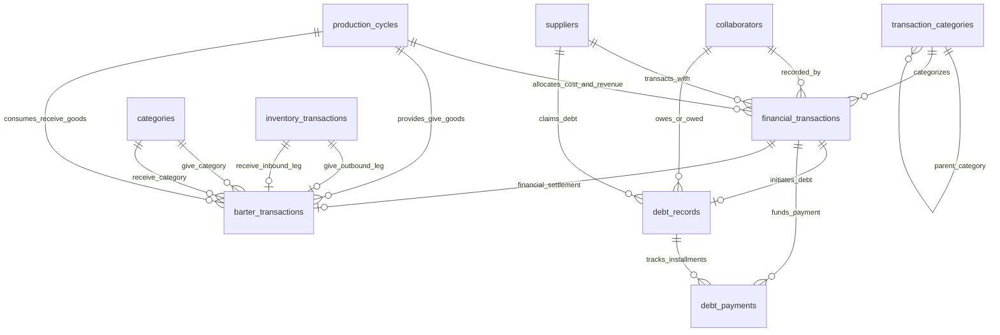

# Thiết Kế Cơ Sở Dữ Liệu Quản Lý Thu Chi, Dòng Tiền & Trao Đổi Hàng Hóa Nông Nghiệp (Transaction Database Architecture)

Tài liệu đặc tả kiến trúc cơ sở dữ liệu quản lý tài chính, thu chi, công nợ và **trao đổi hàng hóa trực tiếp phi tiền tệ** (Financial, Cashflow & Barter Exchange Engine) cho hệ thống trợ lý ảo nông nghiệp **AgriVoice-AI**. Phân hệ được thiết kế để giải quyết bài toán ghi nhận dòng tiền và giá trị thực tế từ giọng nói của nhà nông, tự động bóc tách chi phí giá thành theo vụ mùa/chu kỳ, quản lý công nợ hai chiều và theo dõi các giao dịch hàng-đổi-hàng mà không đòi hỏi nghiệp vụ kế toán phức tạp.

> **Quy ước liên kết liên phân hệ**:
> - **Kho vận (Inventory)**: Mua bán vật tư, xuất/nhập trao đổi hàng hóa liên kết với đối tác (`suppliers`), nhóm hàng hóa phân cấp (`categories`), và nhật ký kho (`inventory_transactions`).
> - **Vận hành (Operation)**: Chi phí và doanh thu (cả tiền mặt lẫn giá trị quy đổi) được hạch toán trực tiếp theo vụ mùa (`production_cycles`) và dự án (`projects`).
> - **Nhân sự (Collaborators)**: Khoản chi trả công nhật, tiền lương hoặc đổi hàng lấy ngày công liên kết trực tiếp với người làm vườn (`collaborators`).

---

## 1. Bối cảnh & Thách thức dòng tiền nông hộ (Financial Reality & Challenges)

### 1.1. Khẩu lệnh thu chi tự nhiên & Đặc thù tiền tệ nông thôn
Trong sinh hoạt và sản xuất nông nghiệp hàng ngày, các khoản tiền ra/vào thường được phát ngôn rất ngắn gọn, chứa tiếng lóng hoặc thông tin không đồng nhất:
- *"Bán 2 tấn cam xoàn thu 40 triệu chuyển khoản"* (thu nhập bán nông sản lớn, thanh toán qua ngân hàng).
- *"Mua 5 bao phân NPK hết 4 triệu hai tiền mặt"* (chi phí vật tư trực tiếp, dùng tiền mặt).
- *"Đại lý Năm Lúa cho nợ 15 triệu tiền giống dưa lưới, hẹn cuối vụ trả"* (phát sinh nợ phải trả, không trả tiền ngay).
- *"Ứng trước cho anh Ba 500 ngàn tiền công xịt thuốc"* (tạm ứng nhân công, chi phí lao động).
- *"Tiền điện bơm nước tháng này hết 1 triệu tám"* (chi phí vận hành chung của trang trại, chia cho nhiều khu vực/vụ mùa).

### 1.2. Mâu thuẫn giữa Kế toán kép (Double-Entry) và Thói quen nông dân
- Các phần mềm kế toán doanh nghiệp bắt buộc định khoản Nợ/Có (Double-entry bookkeeping), tài khoản ngân hàng, hóa đơn GTGT. Điều này hoàn toàn xa lạ và gây quá tải cho nông dân.
- Nhà nông quản lý tài chính theo nguyên tắc **dòng tiền thực tế (Cash-basis Stream)**: Tiền thực nhận vào túi (Income), Tiền thực chi ra (Expense) và Sổ ghi nợ (Debt Book). Hệ thống AgriVoice-AI áp dụng mô hình dòng tiền đơn giản hóa này kết hợp với khả năng tự động phân bổ chi phí của AI.

### 1.3. Hạch toán giá thành vụ mùa (Cycle Costing) vs Chi phí chung trang trại (Overhead)
Để biết một vụ dưa lưới hay một lứa gà thực sự lời hay lỗ, hệ thống phải tách bạch:
- **Chi phí trực tiếp (Direct Cost)**: Gắn liền với một `cycle_id` cụ thể (tiền giống, tiền phân bón, thuốc BVTV dùng riêng cho lứa đó, tiền công thu hoạch).
- **Chi phí chung / Gián tiếp (Overhead Cost)**: Không gắn riêng với vụ nào (`cycle_id IS NULL`, ví dụ: tiền điện trạm bơm chung, tiền mua máy cắt cỏ, bảo dưỡng máy kéo).

### 1.4. Quản lý công nợ hai chiều linh hoạt (Two-way Debt Tracking)
Nông nghiệp nông thôn vận hành dựa trên chữ tín và công nợ gối đầu:
- **Nợ phải trả (Payables)**: Nợ đại lý tiền vật tư/cám/giống, thanh toán sau khi thu hoạch xuất bán.
- **Nợ phải thu (Receivables)**: Thương lái hoặc công ty thu mua chưa trả hết tiền nông sản, cho nợ lại một phần.
- Hệ thống cần theo dõi lịch sử trả nợ nhiều lần (Partial Payments) đến khi tất toán dứt điểm.

### 1.5. Giao dịch trao đổi hàng hóa trực tiếp phi tiền tệ (Direct Barter Trade & In-Kind Exchanges)
Trong kinh tế nông nghiệp nông thôn, các giao dịch **"hàng đổi hàng" (Barter Trade)** không thông qua tiền mặt diễn ra rất thường xuyên:
- **Đổi nông sản lấy vật tư/thức ăn**: *"Đổi 10 bao ngô hạt lấy 3 bao cám gà công nghiệp với nhà anh Bảy"*.
- **Đổi phụ phẩm lấy cây giống/vật tư**: *"Đem 2 xe phân chuồng đổi lấy 50 cây giống mít Thái"*.
- **Đổi hàng có bù trừ tiền mặt**: *"Đổi con bò đực lấy chiếc máy xới mini của chú Tư, bù thêm 3 triệu tiền mặt"*.
- **Đổi hàng lấy ngày công lao động**: *"Cắt 2 buồng chuối biếu anh Ba để đổi lấy 1 ngày công phụ tỉa cành cam"*.

> **Nguy cơ nếu bỏ sót Barter Trade**: Nếu hệ thống chỉ ghi nhận dòng tiền thuần túy, kho sẽ bị thất thoát ảo (ngô, chuối biến mất không rõ lý do; cám, cây giống tự nhiên xuất hiện trong kho mà không có hóa đơn mua), đồng thời chi phí và doanh thu thực tế của các vụ mùa sẽ bị sai lệch hoàn toàn.

---

## 2. Các nguyên lý thiết kế tài chính cốt lõi (Core Financial Design Principles)

### 2.1. Quản lý số tiền bằng số nguyên tuyệt đối (Integer-based Currency)
- Mọi trường tiền tệ (`amount`, `unit_cost_vnd`, `cash_difference_vnd`) đều lưu trữ dưới dạng số nguyên (`INTEGER`) theo đơn vị đồng Việt Nam (**VND**).
- **Tuyệt đối không dùng số thực (`REAL`/`FLOAT`)** cho tiền tệ để tránh lỗi sai số làm tròn dấu phẩy động trong quá trình cộng dồn hoặc tính toán báo cáo tài chính.

### 2.2. Sổ cái dòng tiền bất biến (Append-only Financial Ledger)
- Mọi bản ghi giao dịch tài chính sau khi đã được duyệt (`COMPLETED`) là **bất biến (Immutable)**.
- Khi có sai sót hoặc hủy giao dịch, hệ thống không xóa bản ghi cũ mà tạo giao dịch bù trừ hoặc chuyển trạng thái `CANCELLED` có lưu vết kiểm toán, bảo đảm số liệu luôn trung thực khi đối soát.

### 2.3. Công thức tính toán chỉ số tài chính vụ mùa (Cycle Financial Metrics)

Doanh thu thực nhận từ chu kỳ $C$ (bao gồm cả giá trị quy đổi từ hàng đổi hàng):

$$\text{Revenue}(C) = \sum \text{amount} \quad \text{với } \text{type} = \text{'INCOME'}, \text{ cycle\_id} = C, \text{ status} = \text{'COMPLETED'}$$

Chi phí trực tiếp của chu kỳ $C$ (bao gồm cả giá trị vật tư nhận về từ hàng đổi hàng):

$$\text{DirectCost}(C) = \sum \text{amount} \quad \text{với } \text{type} = \text{'EXPENSE'}, \text{ cycle\_id} = C, \text{ status} = \text{'COMPLETED'}$$

Lợi nhuận gộp thực tế của chu kỳ $C$:

$$\text{GrossProfit}(C) = \text{Revenue}(C) - \text{DirectCost}(C)$$

Tỉ suất sinh lời trên chi phí trực tiếp (ROI):

$$\text{ROI}(C) = \frac{\text{GrossProfit}(C)}{\text{DirectCost}(C)} \times 100\% \quad (\text{với } \text{DirectCost}(C) > 0)$$

---

### 2.4. Công thức theo dõi trạng thái công nợ (Debt Status Equation)

Đối với mỗi khoản nợ phát sinh ban đầu $D_{\text{initial}}$:
- Tổng số tiền đã thanh toán hoàn trả lũy kế:

$$P_{\text{paid}} = \sum \text{amount}_{\text{payment}}$$

- Số dư công nợ còn lại tại thời điểm $t$:

$$D_{\text{remaining}} = D_{\text{initial}} - P_{\text{paid}}$$

- Phân loại trạng thái công nợ:
  - $D_{\text{remaining}} = 0 \implies \text{'SETTLED'}$ (Đã tất toán xong).
  - $0 < D_{\text{remaining}} < D_{\text{initial}} \implies \text{'PARTIAL'}$ (Đã trả một phần).
  - $D_{\text{remaining}} = D_{\text{initial}} \implies \text{'UNPAID'}$ (Chưa thanh toán).
  - $t_{\text{now}} > \text{due\_date} \land D_{\text{remaining}} > 0 \implies \text{'OVERDUE'}$ (Quá hạn thanh toán).

---

### 2.5. Nguyên lý hạch toán trao đổi hàng hóa (Barter Valuation & Dual-Leg Ingestion)

Mỗi giao dịch trao đổi hàng hóa trực tiếp được cấu thành từ hai vế đối ứng đồng thời (**Dual-Leg Synchronization**):
1. **Vế Xuất (Outbound Leg - Hàng đem đổi)**:
   - Ghi nhận một phiếu xuất kho `ISSUE` trên bảng `inventory_transactions` với số lượng $Q_{\text{give}}$ thuộc nhóm `give_category_id`.
   - Nếu hàng này thuộc sản phẩm của chu kỳ $C_{\text{give}}$, chu kỳ đó được ghi nhận một khoản doanh thu quy ước bằng giá trị thị trường ước tính $V_{\text{barter}}$.
2. **Vế Nhập (Inbound Leg - Hàng nhận về)**:
   - Ghi nhận một phiếu nhập kho `RECEIPT` trên bảng `inventory_transactions` với số lượng $Q_{\text{receive}}$ thuộc nhóm `receive_category_id`.
   - Nếu hàng này được đưa vào sử dụng cho chu kỳ $C_{\text{receive}}$, chu kỳ đó được tính một khoản chi phí vật tư trực tiếp quy ước bằng $V_{\text{barter}}$.
3. **Khoản tiền chênh lệch bù trừ ($\Delta_{\text{cash}}$)**:
   - Nếu hai vế đổi ngang giá trị: $\Delta_{\text{cash}} = 0$ (Phương thức thanh toán thuần `BARTER`, dòng tiền mặt phát sinh $= 0$).
   - Nếu hàng nhận về có giá trị cao hơn hàng đem đổi: Trang trại phải bù thêm tiền:
     $$\Delta_{\text{cash}} = V_{\text{receive}} - V_{\text{give}} > 0 \implies \text{Tạo giao dịch EXPENSE bù tiền mặt/chuyển khoản}$$
   - Nếu hàng đem đổi có giá trị cao hơn hàng nhận về: Đối tác phải bù tiền cho trang trại:
     $$\Delta_{\text{cash}} = V_{\text{receive}} - V_{\text{give}} < 0 \implies \text{Tạo giao dịch INCOME thu thêm tiền mặt/chuyển khoản}$$

---

## 3. Chi tiết lược đồ cơ sở dữ liệu (Data Schema Specification)

### 3.1. Danh mục thu chi (`transaction_categories`)
Quản lý cây phân loại mục đích dòng tiền, giúp phân loại chi phí (giống, phân, thuốc, điện nước, nhân công) và nguồn thu (bán quả, bán thịt, bán phụ phẩm, doanh thu quy đổi từ trao đổi hàng).

| Tên cột | Kiểu dữ liệu | Ràng buộc | Mục đích & Ý nghĩa |
| :--- | :--- | :--- | :--- |
| `category_id` | `INTEGER` | `PRIMARY KEY AUTOINCREMENT` | Khóa chính định danh danh mục thu/chi. |
| `code` | `TEXT` | `NOT NULL UNIQUE` | Mã danh mục ngắn gọn (ví dụ: `REV_FRUIT`, `EXP_FERT`, `BARTER_EXCHANGE`). |
| `name` | `TEXT` | `NOT NULL UNIQUE` | Tên danh mục (ví dụ: *Tiền bán nông sản*, *Tiền phân bón*, *Quy đổi hàng đổi hàng*). |
| `type` | `TEXT` | `NOT NULL CHECK (type IN ('INCOME', 'EXPENSE'))` | Loại dòng tiền: `INCOME` (Khoản thu), `EXPENSE` (Khoản chi). |
| `parent_id` | `INTEGER` | `NULL REFERENCES transaction_categories(category_id)` | Danh mục cha (hỗ trợ phân nhóm chi tiết). |
| `is_cycle_mandatory`| `INTEGER` | `NOT NULL DEFAULT 0 CHECK (is_cycle_mandatory IN (0, 1))` | Cờ bắt buộc phải gắn với vụ mùa (`1`: bắt buộc có `cycle_id`, `0`: cho phép chi chung trang trại). |
| `convenient_names` | `TEXT` | `NULL` | Danh sách JSON khẩu ngữ nhà nông (ví dụ: `["tiền bán trái", "tiền cám", "tiền công", "đổi hàng"]`). |
| `description` | `TEXT` | `NULL` | Hướng dẫn định khoản và phân loại chi tiết. |
| `is_active` | `INTEGER` | `NOT NULL DEFAULT 1 CHECK (is_active IN (0, 1))` | Trạng thái sử dụng (1: khả dụng, 0: ngưng dùng). |
| `created_at` | `TEXT` | `NOT NULL DEFAULT CURRENT_TIMESTAMP` | Thời điểm tạo. |
| `updated_at` | `TEXT` | `NOT NULL DEFAULT CURRENT_TIMESTAMP` | Thời điểm cập nhật cuối cùng. |

---

### 3.2. Sổ giao dịch thu chi tài chính (`financial_transactions`)
Bảng trung tâm ghi nhận từng sự kiện phát sinh dòng tiền hoặc giá trị thanh toán thực tế trong trang trại.

| Tên cột | Kiểu dữ liệu | Ràng buộc | Mục đích & Ý nghĩa |
| :--- | :--- | :--- | :--- |
| `transaction_id` | `INTEGER` | `PRIMARY KEY AUTOINCREMENT` | Khóa chính giao dịch tài chính. |
| `cycle_id` | `INTEGER` | `NULL REFERENCES production_cycles(cycle_id) ON DELETE SET NULL` | Thuộc chu kỳ/vụ mùa nào (NULL nếu là chi phí vận hành chung của trang trại). |
| `category_id` | `INTEGER` | `NOT NULL REFERENCES transaction_categories(category_id) ON DELETE RESTRICT` | Mục đích thu chi. |
| `supplier_id` | `INTEGER` | `NULL REFERENCES suppliers(supplier_id) ON DELETE SET NULL` | Đại lý / Nhà cung cấp liên quan (nếu mua vật tư). |
| `recorded_by` | `INTEGER` | `NULL REFERENCES collaborators(collaborator_id) ON DELETE SET NULL` | Nhân sự / Cộng tác viên thực hiện hoặc ghi nhận giao dịch. |
| `type` | `TEXT` | `NOT NULL CHECK (type IN ('INCOME', 'EXPENSE'))` | Bản chất dòng tiền/giá trị (`INCOME`: thu vào, `EXPENSE`: chi ra). |
| `amount` | `INTEGER` | `NOT NULL CHECK (amount >= 0)` | **Số tiền giao dịch thực tế hoặc giá trị quy ước (VND).** Cho phép `= 0` khi đổi ngang thuần túy. |
| `transaction_date`| `TEXT` | `NOT NULL` | Ngày phát sinh giao dịch (`YYYY-MM-DD`). |
| `partner_name` | `TEXT` | `NULL` | Tên đối tác, thương lái, người nhận tiền hoặc bên trao đổi hàng hóa (ví dụ: *Anh Năm Lúa*, *Chú Tư máy cày*). |
| `payment_method` | `TEXT` | `NOT NULL DEFAULT 'CASH' CHECK (payment_method IN ('CASH', 'TRANSFER', 'DEBT', 'BARTER'))` | Phương thức: `CASH` (Tiền mặt), `TRANSFER` (Chuyển khoản), `DEBT` (Công nợ), `BARTER` (Hàng đổi hàng trực tiếp). |
| `status` | `TEXT` | `NOT NULL DEFAULT 'COMPLETED' CHECK (status IN ('COMPLETED', 'PENDING', 'CANCELLED'))` | Trạng thái giao dịch (`COMPLETED`: đã xong, `PENDING`: chờ duyệt, `CANCELLED`: đã hủy). |
| `barter_id` | `INTEGER` | `NULL REFERENCES barter_transactions(barter_id) ON DELETE SET NULL` | Khóa ngoại liên kết bảng chi tiết đổi hàng (nếu là giao dịch Barter). |
| `invoice_image_path`| `TEXT`| `NULL` | Đường dẫn lưu ảnh chụp hóa đơn, giấy biên nhận, phiếu cân hàng trên thiết bị. |
| `inventory_transaction_id`| `INTEGER`| `NULL REFERENCES inventory_transactions(transaction_id) ON DELETE SET NULL` | Phiếu kho tương ứng (nếu mua/bán vật tư hoặc nông sản có nhập/xuất kho). |
| `pending_event_id`| `INTEGER` | `NULL REFERENCES pending_events(event_id) ON DELETE SET NULL` | ID sự kiện In-Flight tương ứng để nghe lại giọng nói gốc. |
| `is_estimated` | `INTEGER` | `NOT NULL DEFAULT 0 CHECK (is_estimated IN (0, 1))` | Cờ đánh dấu số tiền do AI tạm ước tính theo đơn giá thị trường (khi nông dân quên nói giá), hỗ trợ rà soát. |
| `notes` | `TEXT` | `NULL` | Ghi chú thêm chi tiết về giao dịch. |
| `created_at` | `TEXT` | `NOT NULL DEFAULT CURRENT_TIMESTAMP` | Thời điểm ghi nhận vào hệ thống. |
---

### 3.3. Sổ theo dõi trao đổi hàng hóa trực tiếp (`barter_transactions`)
Bảng chuyên trách quản lý quan hệ đối ứng khi hai bên trao đổi vật tư/nông sản mà không dùng hoặc chỉ dùng một phần tiền mặt.

| Tên cột | Kiểu dữ liệu | Ràng buộc | Mục đích & Ý nghĩa |
| :--- | :--- | :--- | :--- |
| `barter_id` | `INTEGER` | `PRIMARY KEY AUTOINCREMENT` | Khóa chính giao dịch trao đổi hàng hóa. |
| `partner_name` | `TEXT` | `NOT NULL` | Tên đối tác thực hiện trao đổi (hộ lân cận, đại lý, thương lái). |
| `give_category_id` | `INTEGER` | `NOT NULL REFERENCES categories(category_id)` | Nhóm hàng trang trại đem đi đổi (từ bảng `categories` phân hệ Kho, ví dụ: *Ngô hạt*, *Phân chuồng*). |
| `give_quantity` | `REAL` | `NOT NULL CHECK (give_quantity > 0)` | Số lượng hàng đem đi đổi. |
| `give_unit` | `TEXT` | `NOT NULL` | Đơn vị tính hàng đem đổi (`bao`, `tấn`, `kg`, `con`). |
| `give_cycle_id` | `INTEGER` | `NULL REFERENCES production_cycles(cycle_id)` | Vụ mùa sản xuất ra món hàng đem đổi (để ghi nhận doanh thu quy đổi). |
| `give_inventory_tx_id`| `INTEGER`| `NULL REFERENCES inventory_transactions(transaction_id)` | Phiếu xuất kho tương ứng của món hàng đem đổi. |
| `receive_category_id` | `INTEGER`| `NOT NULL REFERENCES categories(category_id)` | Nhóm hàng trang trại nhận về (từ bảng `categories` phân hệ Kho, ví dụ: *Cám gà*, *Cây giống cam*). |
| `receive_quantity` | `REAL` | `NOT NULL CHECK (receive_quantity > 0)` | Số lượng hàng nhận về. |
| `receive_unit` | `TEXT` | `NOT NULL` | Đơn vị tính hàng nhận về (`bao`, `cây`, `kg`). |
| `receive_cycle_id` | `INTEGER` | `NULL REFERENCES production_cycles(cycle_id)` | Vụ mùa tiếp nhận sử dụng hàng nhận về (để tính chi phí vật tư quy đổi). |
| `receive_inventory_tx_id`| `INTEGER`| `NULL REFERENCES inventory_transactions(transaction_id)` | Phiếu nhập kho tương ứng của món hàng nhận về. |
| `estimated_value_vnd` | `INTEGER` | `NOT NULL DEFAULT 0 CHECK (estimated_value_vnd >= 0)` | Giá trị ước tính quy đổi tương đương của giao dịch (VND) để tính giá thành vụ mùa. |
| `cash_difference_vnd` | `INTEGER` | `NOT NULL DEFAULT 0` | Số tiền bù chênh lệch: $>0$ nếu trang trại phải trả thêm tiền mặt, $<0$ nếu trang trại thu thêm tiền, $=0$ nếu đổi ngang giá. |
| `payment_transaction_id`| `INTEGER`| `NULL REFERENCES financial_transactions(transaction_id)` | Phiếu chi/thu tiền mặt đối ứng (nếu có tiền chênh lệch bù trừ $\Delta_{\text{cash}} \neq 0$). |
| `status` | `TEXT` | `NOT NULL DEFAULT 'COMPLETED' CHECK (status IN ('COMPLETED', 'PENDING', 'CANCELLED'))` | Trạng thái giao dịch trao đổi. |
| `notes` | `TEXT` | `NULL` | Ghi chú thỏa thuận quy đổi giữa hai bên. |
| `pending_event_id`| `INTEGER` | `NULL REFERENCES pending_events(event_id) ON DELETE SET NULL` | ID sự kiện In-Flight tương ứng để nghe lại giọng nói gốc về vụ trao đổi. |
| `created_at` | `TEXT` | `NOT NULL DEFAULT CURRENT_TIMESTAMP` | Thời điểm phát sinh giao dịch. |
---

### 3.4. Sổ theo dõi công nợ chi tiết (`debt_records`)
Quản lý các khoản nợ cần thanh toán hoặc cần thu hồi theo thời gian, hỗ trợ trả dần nhiều đợt.

| Tên cột | Kiểu dữ liệu | Ràng buộc | Mục đích & Ý nghĩa |
| :--- | :--- | :--- | :--- |
| `debt_id` | `INTEGER` | `PRIMARY KEY AUTOINCREMENT` | Khóa chính khoản nợ. |
| `initial_transaction_id`| `INTEGER`| `NOT NULL REFERENCES financial_transactions(transaction_id) ON DELETE RESTRICT` | Giao dịch gốc làm phát sinh khoản nợ này (`payment_method = 'DEBT'`). |
| `debt_type` | `TEXT` | `NOT NULL CHECK (debt_type IN ('PAYABLE', 'RECEIVABLE'))` | Bản chất nợ: `PAYABLE` (Nợ trang trại phải trả đại lý), `RECEIVABLE` (Nợ trang trại phải thu từ thương lái/khách). |
| `partner_name` | `TEXT` | `NOT NULL` | Tên chủ nợ hoặc con nợ (ví dụ: *Đại lý phân bón Năm Lúa*, *Thương lái Tám Hưng*). |
| `supplier_id` | `INTEGER` | `NULL REFERENCES suppliers(supplier_id)` | Khóa ngoại trỏ về nhà cung cấp (nếu là nợ vật tư). |
| `collaborator_id` | `INTEGER` | `NULL REFERENCES collaborators(collaborator_id)` | Khóa ngoại nhân sự (nếu là nợ tiền công / tạm ứng). |
| `initial_amount` | `INTEGER` | `NOT NULL CHECK (initial_amount > 0)` | Số tiền nợ ban đầu (VND). |
| `paid_amount` | `INTEGER` | `NOT NULL DEFAULT 0 CHECK (paid_amount >= 0 AND paid_amount <= initial_amount)` | Lũy kế số tiền đã thanh toán/thu hồi (VND). |
| `remaining_amount`| `INTEGER` | `GENERATED ALWAYS AS (initial_amount - paid_amount) VIRTUAL` | Số nợ còn lại (tự động tính). |
| `due_date` | `TEXT` | `NULL` | Hạn chót thanh toán theo thỏa thuận (`YYYY-MM-DD`). |
| `status` | `TEXT` | `NOT NULL DEFAULT 'UNPAID' CHECK (status IN ('UNPAID', 'PARTIAL', 'SETTLED', 'CANCELLED'))` | Trạng thái nợ: `UNPAID` (chưa trả), `PARTIAL` (đã trả một phần), `SETTLED` (đã tất toán xong), `CANCELLED` (hủy bỏ/xóa nợ). |
| `notes` | `TEXT` | `NULL` | Ghi chú thỏa thuận trả nợ, cam kết. |
| `pending_event_id`| `INTEGER` | `NULL REFERENCES pending_events(event_id) ON DELETE SET NULL` | ID sự kiện In-Flight tương ứng để nghe lại giọng nói thỏa thuận nợ. |
| `created_at` | `TEXT` | `NOT NULL DEFAULT CURRENT_TIMESTAMP` | Ngày ghi nhận khoản nợ. |
| `updated_at` | `TEXT` | `NOT NULL DEFAULT CURRENT_TIMESTAMP` | Ngày cập nhật tiến độ thanh toán. |
---

### 3.5. Nhật ký thanh toán trả nợ từng lần (`debt_payments`)
Lưu trữ từng lần thanh toán cấn trừ vào khoản nợ lớn.

| Tên cột | Kiểu dữ liệu | Ràng buộc | Mục đích & Ý nghĩa |
| :--- | :--- | :--- | :--- |
| `payment_id` | `INTEGER` | `PRIMARY KEY AUTOINCREMENT` | Khóa chính lần trả nợ. |
| `debt_id` | `INTEGER` | `NOT NULL REFERENCES debt_records(debt_id) ON DELETE CASCADE` | Thuộc khoản nợ nào. |
| `payment_transaction_id`| `INTEGER`| `NOT NULL REFERENCES financial_transactions(transaction_id) ON DELETE RESTRICT` | Giao dịch tiền mặt/chuyển khoản đối ứng ghi nhận dòng tiền trả nợ. |
| `amount_paid` | `INTEGER` | `NOT NULL CHECK (amount_paid > 0)` | Số tiền thanh toán đợt này (VND). |
| `payment_date` | `TEXT` | `NOT NULL` | Ngày thanh toán (`YYYY-MM-DD`). |
| `notes` | `TEXT` | `NULL` | Ghi chú (ví dụ: *Trả đợt 1 tiền mua giống dưa lưới*). |
| `created_at` | `TEXT` | `NOT NULL DEFAULT CURRENT_TIMESTAMP` | Thời điểm ghi nhận. |

---

### 3.6. Khung nhìn tổng hợp tài chính vụ mùa (`v_cycle_financial_summary`)
Khung nhìn (SQL View) tự động kết xuất kết quả kinh doanh, tổng thu, tổng chi và lợi nhuận ròng của từng vụ mùa/chu kỳ nuôi trồng (đã bao gồm giá trị quy đổi từ hàng đổi hàng).

```sql
CREATE VIEW IF NOT EXISTS v_cycle_financial_summary AS
SELECT 
    c.cycle_id,
    c.name AS cycle_name,
    c.status AS cycle_status,
    c.start_date,
    c.actual_end_date,
    p.name AS project_name,
    z.zone_name,
    -- Tong thu tu ban nong san vu mua (tien mat, chuyen khoan va gia tri quy doi doi hang)
    COALESCE(SUM(CASE WHEN ft.type = 'INCOME' AND ft.status = 'COMPLETED' THEN ft.amount ELSE 0 END), 0) AS total_income_vnd,
    -- Tong chi phi truc tiep cho vu mua (tien vat tu, cong tho va vat tu nhan ve tu doi hang)
    COALESCE(SUM(CASE WHEN ft.type = 'EXPENSE' AND ft.status = 'COMPLETED' THEN ft.amount ELSE 0 END), 0) AS total_expense_vnd,
    -- Loi nhuan rong thuc te
    COALESCE(SUM(CASE WHEN ft.type = 'INCOME' AND ft.status = 'COMPLETED' THEN ft.amount ELSE 0 END), 0) -
    COALESCE(SUM(CASE WHEN ft.type = 'EXPENSE' AND ft.status = 'COMPLETED' THEN ft.amount ELSE 0 END), 0) AS net_profit_vnd,
    -- Ty suat loi nhuan ROI (%)
    CASE 
        WHEN COALESCE(SUM(CASE WHEN ft.type = 'EXPENSE' AND ft.status = 'COMPLETED' THEN ft.amount ELSE 0 END), 0) > 0 
        THEN ROUND(
            (
                (COALESCE(SUM(CASE WHEN ft.type = 'INCOME' AND ft.status = 'COMPLETED' THEN ft.amount ELSE 0 END), 0) -
                 COALESCE(SUM(CASE WHEN ft.type = 'EXPENSE' AND ft.status = 'COMPLETED' THEN ft.amount ELSE 0 END), 0)) * 100.0
            ) / SUM(CASE WHEN ft.type = 'EXPENSE' AND ft.status = 'COMPLETED' THEN ft.amount ELSE 0 END),
            2
        )
        ELSE NULL 
    END AS roi_percentage,
    COUNT(ft.transaction_id) AS total_transaction_count
FROM production_cycles c
LEFT JOIN projects p ON c.project_id = p.project_id
LEFT JOIN zones z ON c.zone_id = z.zone_id
LEFT JOIN financial_transactions ft ON c.cycle_id = ft.cycle_id
GROUP BY c.cycle_id, c.name, c.status, c.start_date, c.actual_end_date, p.name, z.zone_name;
```

---

### 3.7. Khung nhìn theo dõi dòng tiền hàng ngày (`v_daily_cashflow_summary`)
Khung nhìn phục vụ báo cáo thu chi quỹ tiền mặt và tài khoản ngân hàng của toàn trang trại theo từng ngày (tách biệt các giao dịch phi tiền tệ `BARTER`).

```sql
CREATE VIEW IF NOT EXISTS v_daily_cashflow_summary AS
SELECT 
    transaction_date,
    payment_method,
    COALESCE(SUM(CASE WHEN type = 'INCOME' THEN amount ELSE 0 END), 0) AS daily_income_vnd,
    COALESCE(SUM(CASE WHEN type = 'EXPENSE' THEN amount ELSE 0 END), 0) AS daily_expense_vnd,
    (COALESCE(SUM(CASE WHEN type = 'INCOME' THEN amount ELSE 0 END), 0) - 
     COALESCE(SUM(CASE WHEN type = 'EXPENSE' THEN amount ELSE 0 END), 0)) AS net_cashflow_vnd,
    COUNT(transaction_id) AS transaction_count
FROM financial_transactions
WHERE status = 'COMPLETED'
  AND payment_method IN ('CASH', 'TRANSFER') -- Chi loc dong tien thuc te, loai bo phi tien te
GROUP BY transaction_date, payment_method;
```

---

## 4. Cơ chế vận hành & Luồng điều phối AI (Operational Workflows & AI Ingestion)

```
[Bác nông dân đọc khẩu lệnh Voice]
                  │
                  ├───────────────────────────────┐
                  ▼ (Giao dịch tiền mặt/chuyển khoản) ▼ (Giao dịch đổi hàng Barter)
       [create_financial_transaction]      [create_barter_transaction]
                  │                               │
                  ▼                               ▼
       [Hàng đợi pending_events]          [Hàng đợi pending_events]
                  │                               │
                  ▼ (Chủ vườn duyệt)              ▼ (Chủ vườn duyệt)
    [Ghi sổ financial_transactions]      [Xử lý liên hoàn 3 bảng]:
                  │                      1. inventory_transactions:
                  ▼                         - Xuất hàng đem đổi (ISSUE)
         [Cập nhật Dòng tiền]               - Nhập hàng nhận về (RECEIPT)
                                         2. barter_transactions:
                                            - Lưu cặp đối ứng và chênh lệch
                                         3. financial_transactions:
                                            - Ghi nhận chi phí/doanh thu quy đổi
                                            - Ghi nhận khoản bù tiền mặt (nếu có)
```

### 4.1. Kịch bản đổi hàng ngang giá thuần túy
1. **Khẩu lệnh**: *"Đổi 10 bao ngô hạt lấy 3 bao cám gà công nghiệp với anh Bảy"*
   - AI nhận diện intent `BARTER_EXCHANGE`:
     - Hàng đem đổi: $10$ bao ngô hạt (`give_category_id`).
     - Hàng nhận về: $3$ bao cám gà (`receive_category_id`).
     - Đối tác: `Anh Bảy`.
     - Tiền chênh lệch: `cash_difference_vnd = 0`.
     - Giá trị quy ước: Ví dụ $3,000,000$ VND (lấy theo đơn giá thị trường hiện tại của ngô/cám).
   - Khi được duyệt, hệ thống tự động:
     - Tạo phiếu xuất kho: `ISSUE 10 bao ngô hạt`.
     - Tạo phiếu nhập kho: `RECEIPT 3 bao cám gà`.
     - Tạo bản ghi `barter_transactions` lưu vết đối ứng.
     - Tạo 2 bản ghi quy đổi tài chính với `payment_method = 'BARTER'`: Doanh thu $3,000,000$ cho vụ ngô và Chi phí $3,000,000$ cho lứa gà.
     - **Không làm thay đổi số dư quỹ tiền mặt** của trang trại.

### 4.2. Kịch bản đổi hàng có bù trừ tiền mặt
1. **Khẩu lệnh**: *"Đem 2 tấn phân bò đổi lấy 50 cây giống cam xoàn của chú Tư, bù thêm 1 triệu tiền mặt cho chú"*
   - AI bóc tách:
     - Hàng đem đổi: $2$ tấn phân chuồng/bò.
     - Hàng nhận về: $50$ cây giống cam xoàn.
     - `cash_difference_vnd = 1000000` (trang trại bù thêm tiền).
   - Hệ thống tự động:
     - Xuất kho $2$ tấn phân bò và Nhập kho $50$ cây giống cam xoàn.
     - Tạo bản ghi `barter_transactions` với `cash_difference_vnd = 1000000`.
     - Tạo giao dịch tài chính dòng tiền: `type = 'EXPENSE'`, `amount = 1000000`, `payment_method = 'CASH'`, `notes = 'Bù tiền mặt đổi 50 cây cam giống lấy 2 tấn phân bò'`.
     - Cập nhật số dư tiền mặt giảm $1,000,000$ VND.

### 4.3. Kịch bản bán nông sản nhận một phần tiền, nợ một phần
1. **Khẩu lệnh**: *"Bán đợt dưa lưới cho anh Ba được 50 triệu, anh Ba trả trước 30 triệu chuyển khoản còn thiếu 20 triệu hẹn tuần sau trả."*
   - AI nhận diện cấu trúc giao dịch phân tách (Split Transaction):
     - Giao dịch 1: `INCOME` $30,000,000$ VND, `payment_method = 'TRANSFER'`, `status = 'COMPLETED'`.
     - Giao dịch 2: `INCOME` $20,000,000$ VND, `payment_method = 'DEBT'`, `partner_name = 'Anh Ba'`, `status = 'PENDING'`.
     - Tự động sinh bản ghi trong `debt_records`: `debt_type = 'RECEIVABLE'`, `initial_amount = 20000000`, `remaining_amount = 20000000`.

---

## 5. Sơ đồ quan hệ thực thể liên phân hệ (Inter-module Entity Relationship Diagram)



> **Ghi chú về tính toàn vẹn liên phân hệ**:
> - `categories`: Tái sử dụng bảng nhóm vật tư từ phân hệ Kho, dùng để định danh hàng đem đổi và hàng nhận về.
> - `inventory_transactions`: Liên kết 1-1 chặt chẽ với hai vế xuất/nhập của một giao dịch đổi hàng.
> - `financial_transactions`: Ghi nhận dòng tiền bù trừ chênh lệch (nếu $\Delta_{\text{cash}} \neq 0$) hoặc giá trị quy ước tương đương.

---

## 6. Kết luận & Khuyến nghị kỹ thuật

1. **Chuẩn hóa số tiền thành Integer VND tuyệt đối**:
   - Loại bỏ hoàn toàn dấu phẩy động trong lưu trữ tiền tệ. Mọi phép tính tổng thu, tổng chi, cấn trừ công nợ và chênh lệch đổi hàng trên SQLite đều là số nguyên chính xác $100\%$, tránh sai lệch tiền tệ.
2. **Đồng bộ hóa hai vế trong giao dịch đổi hàng Barter**:
   - Khi ghi nhận một giao dịch `barter_transactions`, phải bọc trong một khối SQLite Transaction (`BEGIN TRANSACTION ... COMMIT`) bao gồm: tạo phiếu xuất kho, tạo phiếu nhập kho, và tạo bản ghi tài chính tương ứng để đảm bảo tính toàn vẹn ACID, không bao giờ xuất hiện tình trạng xuất kho hàng đem đổi nhưng chưa ghi nhận nhập kho hàng nhận về.
3. **Phân tách rạch ròi Dòng tiền mặt (Cashflow) và Giá thành vụ mùa (Cost Accounting)**:
   - Giao dịch đổi hàng không làm phát sinh dòng tiền mặt (hoặc chỉ phát sinh phần chênh lệch bù trừ), nhưng vẫn phải được tính vào chi phí và doanh thu của các chu kỳ vụ mùa tương ứng thông qua giá trị quy ước `estimated_value_vnd`.
4. **Tối ưu hóa báo cáo trên thiết bị nhúng Raspberry Pi**:
   - Việc tách riêng view dòng tiền thực tế (`v_daily_cashflow_summary`) và view hiệu quả kinh doanh vụ mùa (`v_cycle_financial_summary`) giúp bot Telegram trả lời câu hỏi của nhà nông ngay tức thì (*"Hôm nay tiền mặt còn bao nhiêu?"* vs *"Vụ cam vừa rồi lời hay lỗ?"*) mà không cần tính toán lặp lại phức tạp.
