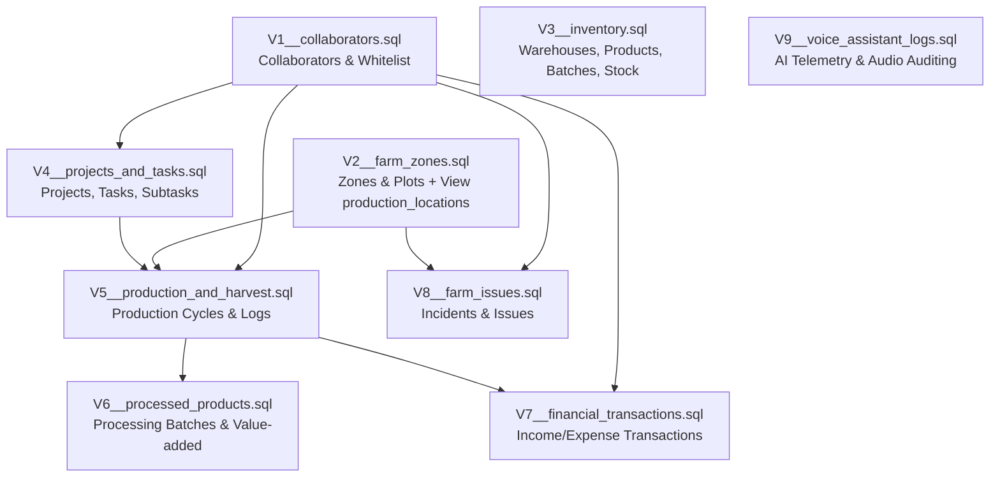

# AgriVoice-AI: Database & Migration Architecture Documentation

Tài liệu thiết kế cơ sở dữ liệu, kiến trúc luồng di trú (Database Migration System), quy chuẩn lược đồ (Schema Design Standards) và hướng dẫn vận hành cho dự án **AgriVoice-AI**.

---

## 1. Tổng quan & Vấn đề trước khi Refactor

Trước khi refactor, thư mục `src/db/migration` tồn tại các hạn chế kỹ thuật:
1. **Lỗi Transaction nesting trong SQLite**:
   - Các file migration (`V6__zones.sql`, `V7__issues.sql`) kết thúc bằng lệnh `COMMIT;` mà không mở `BEGIN TRANSACTION;`. Khi được thực thi bởi SQLite script runner, điều này gây lỗi `cannot commit - no transaction is active`.
2. **Xung đột & trùng lặp thực thể (Redundancy & Conflict)**:
   - File `V2__tasks.sql` định nghĩa bảng `projects`.
   - File `V3__harvest.sql` tiếp tục khai báo lại `CREATE TABLE IF NOT EXISTS projects` với cấu trúc cột ngày tháng (`expected_end_date`, `actual_end_date`) khác so với `V2` (`due_date`).
   - File `V3__harvest.sql` tạo bảng `production_locations`, trong khi `V6__zones.sql` lại tạo bảng `zones` đại diện cho cùng một thực thể không gian canh tác nhưng có khóa chính khác kiểu (`INTEGER` vs `TEXT`).
   - File `V7__issues.sql` tham chiếu khóa ngoại đến `zones(zone_id)` (kiểu `TEXT`), dẫn đến sự phân mảnh giữa `production_locations` và `zones`.
3. **Thứ tự phụ thuộc dữ liệu (Dependency Graph Ordering)**:
   - Bảng tài khoản / cộng tác viên (`collaborators` trong `V9__whitelist.sql`) được tạo sau cùng, khiến các bảng công việc (`tasks`), sự cố (`issues`), tài chính (`financial_transactions`) không thể thiết lập Foreign Key ràng buộc đến người thực hiện.
4. **Thiếu cơ chế chạy migration tự động**:
   - Dự án chỉ có file rỗng `flyway.conf`, không có công cụ tự động hóa việc thực thi và ghi nhận lịch sử áp dụng migration cho môi trường runtime Python.

---

## 2. Kiến trúc luồng di trú sau khi Refactor

Hệ thống di trú được cấu trúc lại hoàn chỉnh theo thứ tự đồ thị phụ thuộc (Topological Dependency Order), tương thích hoàn toàn chuẩn **Flyway** và cung cấp **Engine Python tích hợp**:



### Danh sách các bản Migration chuẩn hóa:

| Phiên bản | Tên tập tin | Nội dung quản lý | Thực thể chính |
| :--- | :--- | :--- | :--- |
| **V1** | `V1__collaborators.sql` | Quản lý danh sách người dùng, phân quyền Telegram & Whitelist | `collaborators` |
| **V2** | `V2__farm_zones.sql` | Phân vùng không gian trang trại (lô, vườn, chuồng, ao). Bổ sung `neighboring_zone_ids` và `convenient_names`. View `production_locations`. | `zones`, `production_locations` (VIEW) |
| **V3** | `V3__inventory.sql` | Quản lý từ điển nông trại hợp nhất (`dictionary`: gộp categories & warehouses, `convenient_names`), vị trí kho `warehouse_id` nullable chống crash, quy đổi đơn vị (`category_unit_conversions`), view `v_inventory_root_summary`. | `dictionary`, `categories` (VIEW), `warehouses` (VIEW), `units`, `category_unit_conversions`, `suppliers`, `product_batches`, `inventory_transactions`, `stock_counts`, `v_inventory_root_summary` (VIEW) |
| **V4** | `V4__projects_and_tasks.sql` | Quản lý dự án tổng hợp, công việc SOP (`time_delta`, `delay`, `last`, ratios), đầu việc con với khóa tài nguyên (`lock`, `glock`). | `projects`, `tasks`, `subtasks`, `tags`, `task_tags`, `task_comments`, `task_activities` |
| **V5** | `V5__production_and_harvest.sql` | Quản lý chu kỳ canh tác kinh tế tuần hoàn (`parent_id`, `categories`), công việc thực thi thực địa (`running_tasks`), thu hoạch và view `v_cycle_yield_performance`. | `production_cycles`, `running_tasks`, `production_logs`, `harvests`, `yield_records`, `v_cycle_yield_performance` (VIEW) |
| **V6** | `V6__processed_products.sql` | Sản phẩm sau chế biến (trà, tinh dầu, sấy), công thức và lô chế biến. | `processed_products`, `processing_batches` |
| **V7** | `V7__financial_transactions.sql` | Thu chi tài chính, trao đổi hàng hóa trực tiếp phi tiền tệ (`barter_transactions`), sổ nợ (`debt_records`), view lãi lỗ vụ mùa và dòng tiền. | `transaction_categories`, `financial_transactions`, `barter_transactions`, `debt_records`, `debt_payments`, `v_cycle_financial_summary` (VIEW), `v_daily_cashflow_summary` (VIEW) |
| **V8** | `V8__farm_issues.sql` | Quản lý sự cố hiện trường liên kết vụ mùa, dự án và task quy trình. | `issues` |
| **V9** | `V9__voice_assistant_logs.sql` | Vùng đệm kiểm duyệt hợp nhất In-Flight Buffer (Strict Ordering, ERROR Logging, Virtual Overlay, Audit Trail). View tương thích ngược `voice_raw_logs`. | `pending_events`, `voice_raw_logs` (VIEW), `v_pending_events_queue`, `v_pending_events_history`, `v_pending_events_errors` |
---

## 3. Chi tiết lược đồ Cơ sở dữ liệu (Database Schema)

### 3.1. Phân hệ Người dùng & Phân quyền (Collaborators)
- **`collaborators`**:
  - `collaborator_id` (`INTEGER PRIMARY KEY AUTOINCREMENT`)
  - `telegram_id` (`TEXT NOT NULL UNIQUE`): Dùng `TEXT` để bảo toàn độ chính xác của 64-bit ID từ Telegram API.
  - `full_name` (`TEXT NOT NULL`)
  - `role` (`TEXT CHECK IN ('OWNER', 'ADMIN', 'WORKER', 'VIEWER')`)
  - `allowed_source` (`TEXT CHECK IN ('PRIVATE', 'GROUP', 'BOTH')`)
  - `is_active` (`INTEGER CHECK IN (0, 1)`)

### 3.2. Phân hệ Vị trí & Phân vùng (Spatial Zones)
- **`zones`**:
  - `zone_id` (`TEXT PRIMARY KEY`): Mã định danh dễ đọc (ví dụ: `KHU_A`, `VUON_CAM_01`).
  - `zone_name` (`TEXT NOT NULL`)
  - `sector` (`TEXT CHECK IN ('CROP', 'LIVESTOCK', 'AQUACULTURE', 'MIXED')`)
  - `area_size` (`REAL CHECK >= 0`), `unit_of_size` (`TEXT DEFAULT 'm2'`)
- **`production_locations` (VIEW)**: View tương thích ngược với hệ thống code cũ, ánh xạ `zone_id` thành `location_id` và `code`.

### 3.3. Phân hệ Kho & Vật tư (Inventory & Warehouses)
- Quản lý đầy đủ chu trình: `suppliers` -> `warehouses` -> `products` -> `product_batches` -> `inventory_transactions`.
- **Ràng buộc toàn vẹn & Triggers tự động**:
  - `trg_transaction_validate_insert`: Chặn giao dịch `POSTED` nếu không đủ số lượng trong lô hàng hoặc sai kho/vị trí.
  - `trg_transaction_apply_insert`: Tự động cộng/trừ số lượng tồn `quantity_remaining` trong `product_batches` khi giao dịch được ghi nhận. Tự động đổi trạng thái lô sang `DEPLETED` khi hết hàng.
  - `trg_transaction_no_edit_posted` & `trg_transaction_no_delete_posted`: Đảm bảo tính bất biến (Immutability/Audit Trail) của chứng từ kho đã ghi sổ (`POSTED`).

### 3.4. Phân hệ Dự án & Công việc (Projects & Tasks)
- **`projects`**: Hợp nhất thống nhất giữa kế hoạch sản xuất và tiến độ chung (`due_date`, `expected_end_date`, `actual_end_date`).
- **`tasks`** & **`subtasks`**: Hỗ trợ phân rã việc nhiều cấp, phân công nhân sự (`assigned_to -> collaborators`), độ ưu tiên, hạn chót.
- **Triggers**:
  - `trg_subtasks_completed`: Khi `is_completed` đổi sang `1`, tự động gán `completed_at = CURRENT_TIMESTAMP`; khi về `0`, tự động đưa về `NULL`.

### 3.5. Phân hệ Canh tác & Thu hoạch (Production & Harvests)
- **`production_cycles`**: Liên kết trực tiếp với `projects` và `zones`.
- **`production_logs`**: Nhật ký công việc canh tác hằng ngày ngoài đồng (tưới tiêu, bón phân, xịt thuốc, cho ăn...).
- **`harvests`** & **`yield_records`**: Quản lý từng đợt thu hoạch, bóc tách sản lượng loại A, loại B, hàng phế phẩm, lượng đưa vào lưu kho và giá trị thương mại.

### 3.6. Phân hệ Sản phẩm chế biến & Tài chính (Value-Added & Finance)
- **`processed_products`** & **`processing_batches`**: Theo dõi nguyên liệu đầu vào từ vụ mùa (`source_cycle_id`) và thành phẩm đầu ra.
- **`financial_transactions`**: Ghi nhận doanh thu bán nông sản / chi phí vật tư, liên kết trực tiếp với từng vụ mùa để tính toán P&L (Lãi/Lỗ).

### 3.7. Phân hệ Sự cố & Vùng đệm kiểm duyệt In-Flight Buffer (V8 & V9)
- **`issues`**: Báo cáo sự cố từ vườn/chuồng, liên kết `cycle_id`, `project_id`, `task_id`. Có trigger `trg_issues_auto_close` tự động điền `closed_at` khi trạng thái chuyển sang `CLOSED`.
- **`pending_events` (Unified In-Flight Buffer - Bảng Chờ Duyệt Hợp Nhất)**:
  - **Mục tiêu**: Toàn bộ update từ Voice AI sẽ chỉ lưu vào V9, tuyệt đối không chèn trực tiếp vào các bảng nghiệp vụ chính khi chưa qua kiểm duyệt. Chủ vườn có thể vắng mặt 2-3 ngày mà hệ thống vẫn vận hành an toàn.
  - **Loại bỏ bảng `voice_raw_logs`**: Tích hợp trực tiếp `audio_path`, `raw_transcript`, `sender_id`, `payload_json` vào `pending_events`, giảm 50% thao tác ghi đĩa trên Raspberry Pi và cung cấp View `voice_raw_logs` tương thích ngược.
  - **Strict Ordering**: Đảm bảo duyệt tuần tự theo thứ tự thời gian (`timestamp ASC, event_id ASC`). Tránh lỗi nghiệp vụ xâu chuỗi (ví dụ duyệt xuất kho trước khi nhập kho).
  - **Audit Trail**: Khi chủ vườn duyệt, dòng dữ liệu **không bị xóa** mà cập nhật trạng thái `APPROVED`, điền `reviewed_by` và tự động cập nhật `reviewed_at`.
  - **Xử lý lỗi thực thi (ERROR Logging & Savepoints)**:
    - Khi chủ vườn duyệt hoặc hệ thống áp dụng `payload_json` vào bảng đích mà gặp lỗi (ví dụ vi phạm ràng buộc CHECK, FOREIGN KEY, kho không đủ hàng), hệ thống tự động rollback savepoint trên bảng đích và cập nhật sự kiện sang trạng thái `ERROR` kèm chi tiết `error_message`.
    - Sự kiện vẫn được bảo toàn nguyên vẹn trong V9 để chủ vườn nghe lại audio, đối chiếu `raw_transcript`, sửa lại payload qua `update_pending_event_payload` và thử duyệt lại.
  - **Views & Triggers**:
    - `v_pending_events_queue`: View lấy danh sách chờ duyệt theo thứ tự thời gian nghiêm ngặt.
    - `v_pending_events_errors`: View danh sách các sự kiện bị lỗi thực thi để chủ vườn rà soát và kiểm tra chi tiết.
    - `v_pending_events_history`: View lịch sử toàn bộ các sự kiện đã duyệt / từ chối / lỗi để tra cứu kiểm toán.
    - `voice_raw_logs`: View tương thích ngược với code đọc nhật ký âm thanh cũ.
    - `trg_pending_events_auto_reviewed_at`: Tự động điền `reviewed_at` khi chuyển sang `APPROVED` hoặc `REJECTED`.
## 4. Hướng dẫn sử dụng & Vận hành

Module cung cấp cả **giao diện dòng lệnh (CLI)** và **Python API programmatic**:

### 4.1. Sử dụng qua dòng lệnh (CLI)

```bash
# 1. Kiểm tra trạng thái các bản di trú (Pending / Success)
python3 -m src.db.migrate status

# 2. Thực thi các bản di trú mới nhất
python3 -m src.db.migrate migrate

# 3. Kiểm tra tính toàn vẹn mã băm (Checksums) của các file di trú so với lịch sử
python3 -m src.db.migrate verify

# 4. (Chỉ dùng cho dev/test) Khởi tạo lại cơ sở dữ liệu từ đầu
python3 -m src.db.migrate reset
```

Có thể chỉ định đường dẫn database tùy ý bằng tham số `--db`:
```bash
python3 -m src.db.migrate migrate --db /path/to/custom_farm.db
```

### 4.2. Sử dụng qua Python Code

Import trực tiếp từ `src.db`:

```python
from src.db import get_db, initialize_database, get_cursor

# 1. Tự động chạy migration khi khởi động ứng dụng
initialize_database()

# 2. Sử dụng Context Manager để thao tác dữ liệu (tự động Commit/Rollback và đóng kết nối)
with get_db() as conn:
    # Truy vấn dữ liệu dưới dạng Dictionary thông qua sqlite3.Row
    collaborator = conn.execute(
        "SELECT * FROM collaborators WHERE telegram_id = ?",
        ("123456789",)
    ).fetchone()
    
    if collaborator:
        print(f"Xin chào: {collaborator['full_name']} ({collaborator['role']})")
```

### 4.3. Sử dụng Dataclass Models (`src/db/models.py`)

Hệ thống cung cấp các dataclass tương ứng với 30 bảng trong database, hỗ trợ định dạng bản ghi (`to_record`), tạo câu lệnh INSERT an toàn (`build_insert_query`), chèn trực tiếp (`insert`), chèn hàng loạt (`insert_many`), và nạp ngược lại từ database (`from_row`):

```python
from src.db import Collaborator, Zone, Task, Issue, VoiceRawLog, get_db

with get_db() as conn:
    # 1. Khởi tạo đối tượng từ dataclass
    worker = Collaborator(
        telegram_id="123456789",
        full_name="Nguyễn Văn Nông",
        role="WORKER",
    )

    # 2. Định dạng thành dictionary bản ghi cho database
    record = worker.to_record()
    # -> {'telegram_id': '123456789', 'full_name': 'Nguyễn Văn Nông', 'role': 'WORKER', 'allowed_source': 'GROUP', 'is_active': 1}

    # 3. Chèn trực tiếp vào cơ sở dữ liệu (tự động gán collaborator_id vừa sinh)
    worker_id = worker.insert(conn)
    print(f"Đã tạo cộng tác viên với ID: {worker_id}")

    # 4. Chèn hàng loạt (Batch Insert)
    zones = [
        Zone(zone_id="KHU_A", zone_name="Vườn Dưa Lưới", sector="CROP", area_size=2000.0),
        Zone(zone_id="KHU_B", zone_name="Vườn Cà Chua", sector="CROP", area_size=1500.0),
    ]
    Zone.insert_many(conn, zones)

    # 5. Đọc từ query và chuyển đổi thành Dataclass instance
    cur = conn.cursor()
    cur.execute("SELECT * FROM collaborators WHERE collaborator_id = ?", (worker_id,))
    loaded_worker = Collaborator.from_row(cur.fetchone())
    print(f"Loaded: {loaded_worker.full_name} ({loaded_worker.role})")
```

### 4.4. Sử dụng Domain Enums (`StrEnum`)

Để tránh gõ sai chuỗi (typo) và đảm bảo an toàn với các ràng buộc `CHECK` trong database, tất cả các trường lựa chọn đều đi kèm Enum kế thừa `StrEnum` (tương thích 100% với kiểu `str`):

```python
from src.db import (
    Collaborator,
    CollaboratorRole,
    AllowedSource,
    Issue,
    IssueSeverity,
    IssueStatus,
    get_db,
)

with get_db() as conn:
    # Truyền Enum hoặc chuỗi đều hợp lệ và được IDE hỗ trợ autocomplete
    admin = Collaborator(
        telegram_id="998877",
        full_name="Kỹ Sư Trưởng",
        role=CollaboratorRole.ADMIN,          # hoặc "ADMIN"
        allowed_source=AllowedSource.BOTH,     # hoặc "BOTH"
    )
    admin.insert(conn)

    issue = Issue(
        zone_id="KHU_A",
        title="Sâu cuốn lá bùng phát",
        severity=IssueSeverity.HIGH,          # 'LOW', 'MEDIUM', 'HIGH', 'CRITICAL'
        status=IssueStatus.OPEN,              # 'OPEN', 'IN_PROGRESS', 'CLOSED', 'CANCELLED'
    )
    issue.insert(conn)
```

---

## 5. Cấu hình Flyway tương thích (flyway.conf)

Nếu dự án được triển khai trên môi trường sử dụng Flyway CLI gốc (Java binary hoặc Docker container), file cấu hình tại `src/db/flyway.conf` đã được thiết lập sẵn sàng:

```ini
flyway.url=jdbc:sqlite:data/agrivoice.db
flyway.locations=filesystem:src/db/migration
flyway.table=flyway_schema_history
flyway.sqlMigrationPrefix=V
flyway.sqlMigrationSeparator=__
flyway.sqlMigrationSuffixes=.sql
flyway.encoding=UTF-8
flyway.validateOnMigrate=true
```

Chạy bằng Flyway CLI tiêu chuẩn:
```bash
flyway -configFiles=src/db/flyway.conf migrate
flyway -configFiles=src/db/flyway.conf info
```

---

## 6. Bộ kiểm thử tự động (Test Suite)

Dự án đi kèm bộ unit test toàn diện tại `tests/test_database.py`.

Để chạy kiểm thử bất cứ lúc nào:
```bash
python3 tests/test_database.py
```

Các ca kiểm thử bao gồm:
1. `test_01_migration_execution_and_history`: Kiểm tra thực thi tuần tự 9 migration, xác nhận bảng lịch sử `flyway_schema_history` và kiểm tra toàn vẹn khóa ngoại `PRAGMA foreign_key_check`.
2. `test_02_idempotency_and_checksum_verification`: Kiểm tra tính lũy kế (idempotency) khi chạy lại nhiều lần và xác thực CRC32 checksums.
3. `test_03_collaborators_and_zones`: Kiểm tra thêm sửa xóa tài khoản, phân vùng và view `production_locations`.
4. `test_04_inventory_triggers_and_immutability`: Kiểm tra logic trigger kho vật tư: trừ tồn kho tự động, tự động đánh dấu hết hàng (`DEPLETED`), chặn xuất vượt số lượng và bảo vệ chứng từ đã ghi sổ (`POSTED`).
5. `test_05_subtasks_and_issues_triggers`: Kiểm tra cập nhật mốc thời gian tự động cho đầu việc con và đóng sự cố nông nghiệp.
